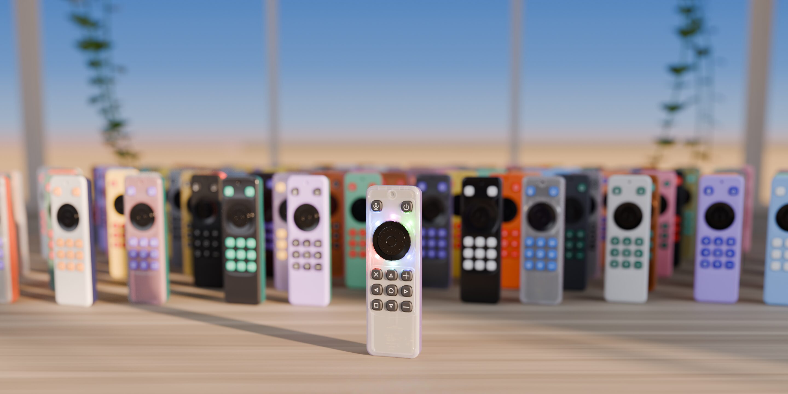
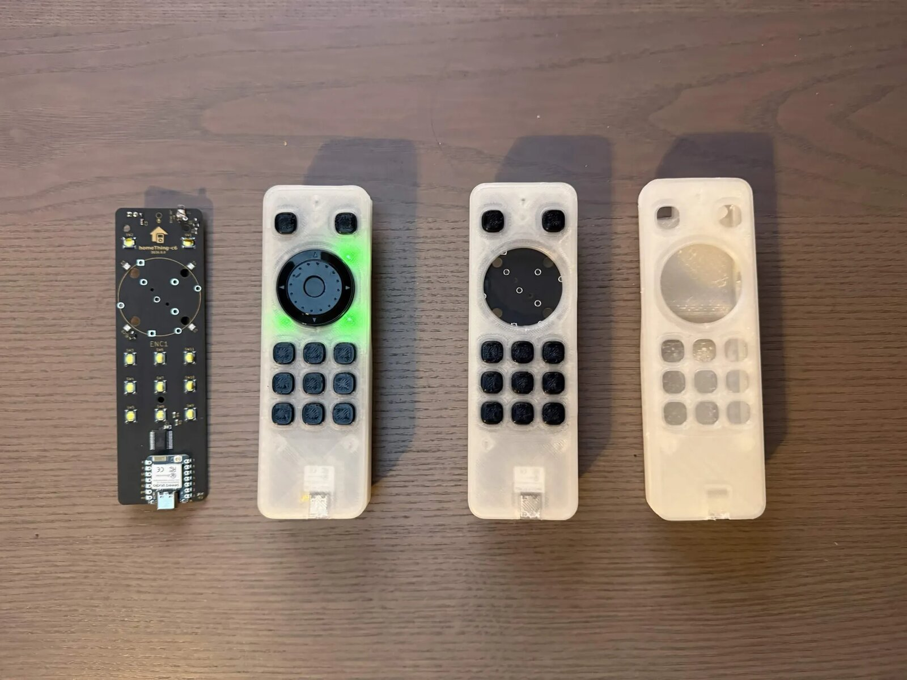
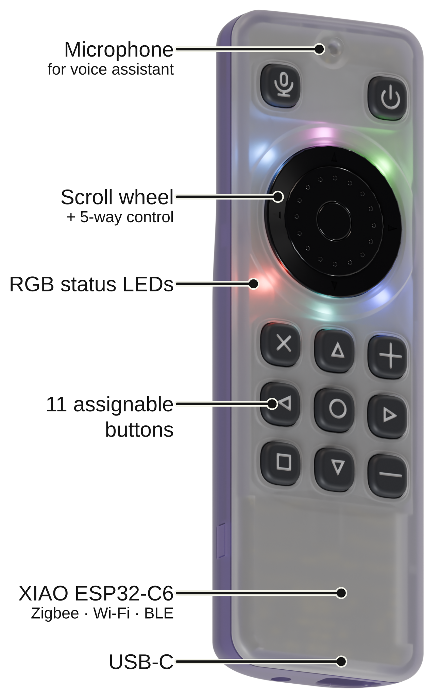
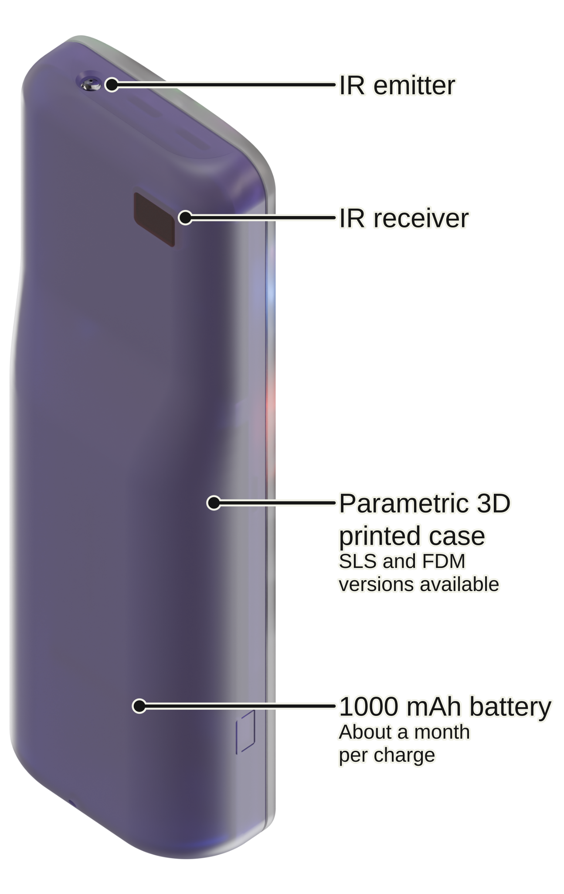
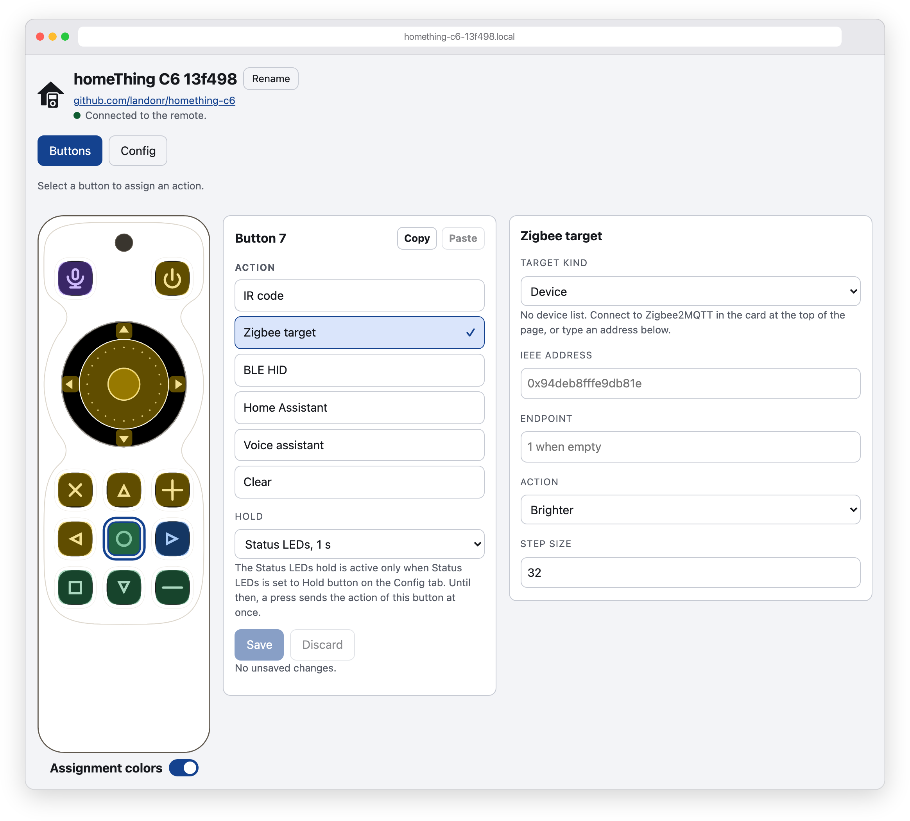
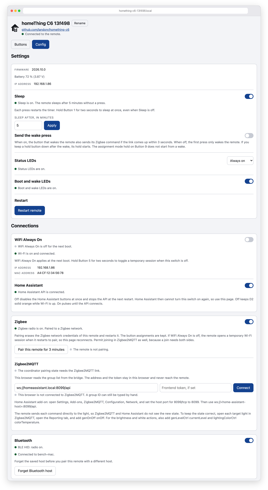
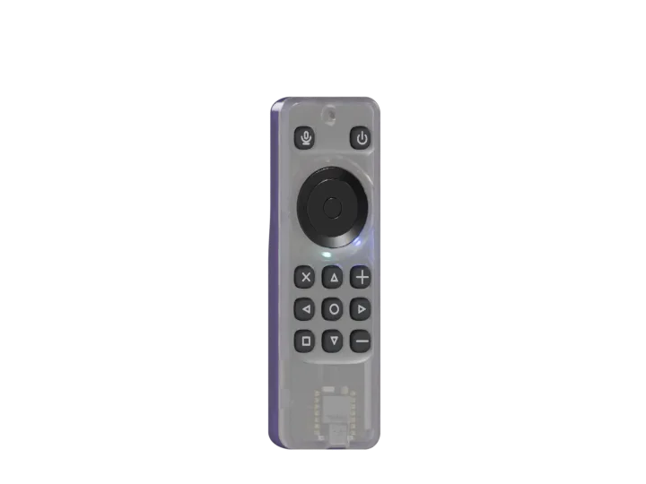
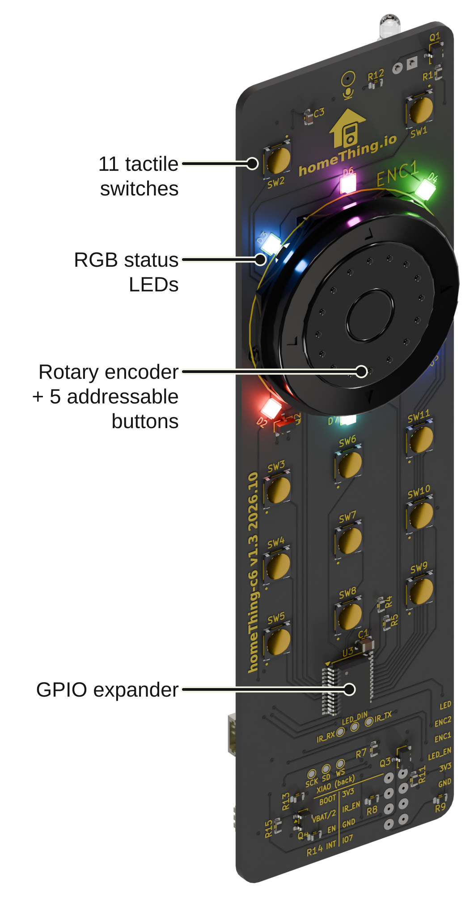

  <picture>
    <source media="(prefers-color-scheme: dark)" srcset="docs/readme-assets/homeThingLogoWhite.svg">
    
  </picture>

<h1 align="center">homeThing C6</h1>

  An open source universal remote that can control anything. 
  For your TV, Sonos, Zigbee lights, and Home Assistant. No touchscreen, no apps, no daily charging.

  <a href="https://landonr.github.io/homething-c6/"><b>landonr.github.io/homething-c6</b></a>

  
  
  
  

  Prototype and fab costs sponsored by <a href="https://pcbway.com/g/Xymq6O">PCBWay</a>. Boards arrive fully assembled, no soldering required.
   
  

  

One button lights the fireplace, another controls the lights, and the rest control the TV. <a href="https://landonr.github.io/homething-c6/">Learn more</a>

## What homeThing C6 does

- **Runs your TV.** It learns the IR codes from the remote you already have. Then the wheel and pad drive the TV.
- **Switches the lights.** A button talks straight to Zigbee lights and groups.
- **Any button, any device.** Each button can drive something different, for example a gas fireplace over Zigbee.
- **Sleeps on its own.** It sleeps between presses, with a target of about a month per charge.
- **No hub needed.** Presses go straight to your Zigbee lights and IR devices. They work without Wi-Fi, Home Assistant, or Zigbee2MQTT.
- **No flashing needed.** Set every button from the remote's own web page, in any browser. You do not edit YAML or rebuild the firmware.
- **Bluetooth keys too.** Pair it like a Bluetooth keyboard or gamepad, and send media keys to a computer, phone, or tablet.
- **Open source, all of it.** The board, the case, and the ESPHome firmware are in this repository.

## Specs

### One remote, no screen.

| Spec | Detail |
| --- | --- |
| **Controls** | Scroll wheel with 5-way pad, 11 assignable buttons |
| **Battery** | 1000 mAh LiPo, with a target of about a month per charge |
| **Charging** | USB-C |
| **Processor** | Seeed Studio XIAO ESP32-C6 |
| **Infrared** | Transmits, receives, and learns codes |
| **Voice** | Microphone for the Home Assistant voice assistant |
| **Status** | 6 RGB LEDs |
| **Case** | 3D printed, SLS or FDM |
| **Wireless** | Wi-Fi, BLE, Zigbee |

## Build one, or get one ready to go

The board arrives fully assembled, so there is no soldering. The board design, the firmware, and the case files are all open source in this repository, so you can build your own from scratch.

- **Case:** The [`case/` README](case/README.md) documents the enclosure files and assembly information.
- **Board:** The [`c6remote-kicad/` README](c6remote-kicad/README.md) documents the KiCad hardware source.
- **Firmware:** The [Make It Yours](#make-it-yours) section documents button assignment. [`c6remote.yaml`](c6remote.yaml) is the ESPHome configuration.
- **Scripts:** The [`scripts/` README](scripts/README.md) documents project utilities and generated assets.

  

V2 board and case

## Your smart home, on real buttons

### Control Anything

Pick it up, press a button, and the lights change. No phone to unlock, no app to open.

- **TV:** Learns the IR codes from the remote you already have, then sends them.
- **Music:** Controls Sonos over Wi-Fi, or pairs with a phone, tablet, or computer over BLE for media keys.
- **Lights:** Talks straight to Zigbee lights and groups.
- **Home Assistant:** Puts any action or script on a button.
- **Voice:** Talks to your Home Assistant voice assistant through the built-in mic.

  <picture>
    <source media="(prefers-color-scheme: dark)" srcset="docs/readme-assets/remote-controls-annotated-dark.svg">
    
  </picture>
  <picture>
    <source media="(prefers-color-scheme: dark)" srcset="docs/readme-assets/remote-back-annotated-dark.svg">
    
  </picture>

## Make It Yours

### Every button is yours to set.

Open the remote's own web page from any browser on your network. Pick a button, then pick what it does: an IR code, a Zigbee light or group, a BLE media key, a Home Assistant action, or voice. You can also assign buttons on the remote itself. No app, no cloud.

#### Button assignment ([more info](RECEIVER.md))

Open `http://homething-c6-xxxxxx.local/` in a browser. `xxxxxx` is the end of the remote's MAC address.
Home Assistant also shows this address as the **Web Page** entity.
To assign buttons on the remote itself, hold `SW9` for two seconds.
[`RECEIVER.md`](RECEIVER.md) has the full steps.
The page has no password, so use it only on a trusted network.

  
  

The Buttons tab with a Zigbee assignment, and the Config tab

## Built Your Way

### Case ([more info](case/README.md))

- Parametric 3D printed case in SLS and FDM versions.
- The SLS front has a shallow dish around the keys and the wheel, and the flat FDM front needs no support on its face.
- Optional Qwiic access: a flush cover with two breakaway bridges stays in place until you need the port.
- Assembly needs one M2 x 5 button-head screw at the grip end.

  

  

SLS front face

### Board ([more info](c6remote-kicad/README.md))

- Custom PCB built around the Seeed Studio XIAO ESP32-C6.
- Sleeps between presses and wakes on any button.

  <picture>
    <source media="(prefers-color-scheme: dark)" srcset="docs/readme-assets/board-front-annotated-dark.svg">
    
  </picture>
  <picture>
    <source media="(prefers-color-scheme: dark)" srcset="docs/readme-assets/board-back-annotated-dark.svg">
    
  </picture>

PCB front and back

  
  

Copper top and bottom

| Ref | Part | Role |
| --- | --- | --- |
| `U1` | [Seeed Studio XIAO ESP32-C6](https://mm.digikey.com/Volume0/opasdata/d220001/medias/docus/8932/102010636.pdf) | Main module: Wi-Fi, BLE, Zigbee/Thread |
| `MK1` | [DMM-4026-B-I2S-R I2S microphone](https://api.puiaudio.com/filename/DMM-4026-B-I2S-R.pdf) | Audio input: PUI Audio bottom-port MEMS part on the back copper, hearing through a 0.5mm NPTH. `LR` and `CONFIG` tie to ground for left-channel output, `C5` decouples VDD and `R12` pulls `sd` down. It replaced the ICS-43434 on 2026-09-07, after three of the five rev-B microphones failed |
| `U2` | [TSOP6136 IR receiver](https://www.vishay.com/docs/82457/tsop61.pdf) | IR receive: Vishay Panhead SMD part on the back copper, listening out the top end wall. AGC1, the most permissive of Vishay's settings, which is what lets `remote_receiver` learn arbitrary remotes. VDD sits on the switched `ir_vdd` rail rather than straight on `+3.3V`, gated by `Q3` below |
| `D1`, `Q1` | [INL-3AHIR30 IR LED](http://www.inolux-corp.com/datasheet/IR/Emitter/3mm%20Lamp/INL-3AHIR30_V1.0.pdf) driven by [MMBT2222A](https://assets.nexperia.com/documents/data-sheet/MMBT2222A.pdf) | IR transmit; D1 leads hand-bent 90° to fire through the top-edge notch (see `BEND 90°` silk mark) |
| `U3` | [PCF8575DBR I2C GPIO expander](https://www.ti.com/lit/ds/symlink/pcf8575.pdf) | Button input fan-out |
| `SW1`–`SW11` | [TL3315NF160Q tactile switches](https://www.e-switch.com/wp-content/uploads/2022/06/TL3315.pdf) | Discrete buttons |
| `ENC1` | [Adafruit ANO rotary encoder](https://cdn-learn.adafruit.com/assets/assets/000/104/942/original/tsw.pdf) | Scroll wheel: encoder channels plus five switch signals |
| `D2`–`D7` | [XL-2020RGBC-WS2812B addressable LEDs](https://mm.digikey.com/Volume0/opasdata/d220001/medias/docus/8903/5962_XL-2020RGBC-WS2812B.pdf) | Status light ring of 6 round the scroll wheel, WS2812B protocol: `GPIO17` drives `D2` DIN, and DOUT cascades clockwise through `D3`, `D6`, `D4`, and `D5` to `D7`. VDD sits on the switched `led_vdd` rail rather than straight on `+3.3V`, gated by `Q2` below, with `C4` as the only bulk cap on the chain (see [`docs/timeline.md`](docs/timeline.md)) |
| `Q2`, `R10`, `C4` | [AO3401A P-channel MOSFET](https://www.aosmd.com/res/datasheets/AO3401A.pdf), 1M 0603 pull-up, 1µF X7R 0805 cap | LED rail load switch: high-side `Q2` gates `+3.3V` (source) onto `led_vdd` (drain) for `D2`–`D7`, gate net `led_en` on `U1` pad 11 (`GPIO18`/`D10`), driven low for rail on. `R10` pulls the gate to the source so the rail is off by default at boot while `GPIO18` floats as an input; `C4` is the mid-chain bulk cap on `led_vdd`. Cuts the ~3.0mA the six LEDs draw when dark to tens of µA (calculated, not yet measured). Firmware must hold `GPIO17` low or high-impedance whenever the rail is down, or DIN pushes current into the dead rail |
| `J1` | [Molex PicoBlade 53261-0271](https://www.molex.com/content/dam/molex/molex-dot-com/products/automated/en-us/salesdrawingpdf/532/53261/532610271_sd.pdf) | Battery connector, PicoBlade 1.25 mm right-angle SMD on the back copper. Its mouth faces `U1`. Pin 1 is BAT, next to the "+" silk. The cell plug is a `51021-0200` housing with `50079-8000` terminals. Cells with 1.25 mm plugs have no standard polarity, so some cells have reversed leads. Before you connect a cell, make sure that its polarity agrees with the silk |
| `J2` | [JST SM04B-SRSS-TB(LF)(SN)](https://www.jst-mfg.com/product/pdf/eng/eSH.pdf) | Qwiic I2C port, SH series right-angle SMD on the back copper. Its mouth faces the long edge opposite `U1`. A Qwiic device must not use `0x20`, the `U3` address |

The auto-generated BOM lives at [c6remote-kicad/export/c6remote-bom.csv](c6remote-kicad/export/c6remote-bom.csv). It tracks the latest repo state and is not release-validated.

#### Schematic

  <picture>
    <source media="(prefers-color-scheme: dark)" srcset="docs/readme-assets/schematic-dark.svg">
    
  </picture>

## Status ([more info](docs/timeline.md))

The fabrication and bring-up history, the rev-B delivery, and the unit 1 versus current design comparison are in [`docs/timeline.md`](docs/timeline.md). Open work is in the [GitHub issues](https://github.com/landonr/homething-c6/issues). The power budget is in [`docs/power-budget.md`](docs/power-budget.md).

## Relationship to homeThing ([more info](https://github.com/landonr/homeThing))

This project grew out of [homeThing](https://github.com/landonr/homeThing) but has a narrower job: instead of a general smart display, it is a simple dedicated remote. It has no screen and more buttons, and is built on a custom PCB that is easy to build.

## License

This repository uses three licenses. A file uses the license of the row that contains its path.

| Path | License |
| --- | --- |
| The ESPHome configs (`c6remote*.yaml`, `secrets.example.yaml`, `partitions.csv`), the root C++ headers (`*.h`), `components/`, `scripts/`, and `.github/` | [GPL-3.0-or-later](LICENSE-GPL-3.0) |
| `c6remote-kicad/` (the schematic, the board, the symbol and footprint libraries, and the `export/` fabrication files), `kicad lib/`, and `case/` (the build123d model source, its checks, the board STEP and DXF files, and the meshes and STEP files that the model exports) | [CERN-OHL-S-2.0](LICENSE-CERN-OHL-S-2.0) |
| The documentation (`README.md`, `RECEIVER.md`, `ZIGBEE.md`, `TRANSMITTING.md`, and `docs/`, with the images in `docs/readme-assets/`), and `site/` | [CC-BY-4.0](LICENSE-CC-BY-4.0) |
| All other files, for example `AGENTS.md`, `.gitignore`, `.gitattributes`, `.mcp.json`, and `.vscode/` | [GPL-3.0-or-later](LICENSE-GPL-3.0) |

A firmware binary that you build from these configs links the GPL-3.0 C++ core of ESPHome. As a result, a distributed binary is GPL-3.0. Its source is this repository and the dependencies below.

For CERN-OHL-S-2.0, the Source Location of the hardware is <https://github.com/landonr/homething-c6>.

### Third-party files

These files keep their own licenses:

| File | Origin | License |
| --- | --- | --- |
| `case/fonts/DejaVuSans.ttf` | DejaVu fonts | Bitstream Vera license, see [`case/fonts/LICENSE`](case/fonts/LICENSE) |
| `scripts/assets/env-studio.hdr` | Poly Haven `studio_small_09` HDRI | CC0-1.0 |
| The Wi-Fi and Bluetooth icons in `site/index.html` | Feather icons | MIT |
| `kicad lib/Library.pretty/LED_D3.0mm_Horizontal_O1.27mm_Z2.0mm_IRBlack.kicad_mod`, and the `SW_TL3315NF160Q` and `TSOP61xx` symbols in `c6remote-kicad/Local.kicad_sym` | KiCad libraries | CC-BY-SA-4.0 with the [KiCad library exception](https://www.kicad.org/libraries/license/) |

Because of the KiCad library exception, CC-BY-SA-4.0 does not apply to a design that uses these items. The schematic and the board also contain stock KiCad symbols and footprints. The same exception applies to them.

These items are not in this repository:

- The KiCad 3D models are in a private repository. See `scripts/link-3dmodels.sh`.
- The build fetches these firmware dependencies:
  - ESPHome: MIT for the Python code, and GPL-3.0 for the C++ code.
  - ESP-IDF and `esp-zigbee-lib`: Apache-2.0.
  - `luar123/zigbee_esphome`: no license file yet. [Issue 119](https://github.com/luar123/zigbee_esphome/issues/119) asks for one.

The licenses do not give rights to trademarks, for example ESPHome, Home Assistant, Seeed Studio XIAO, Adafruit ANO, Discord, and GitHub. Some of these trademarks are in images, for example `site/assets/legacy/s3-video.jpg`.

# Includes
- <a href="https://esphome.io/">ESPHome</a>
- <a href="https://dejavu-fonts.github.io/">DejaVu Sans Bold</a>, used for the board silkscreen brand text
- [@luar123](https://github.com/luar123)'s <a href="https://github.com/luar123/zigbee_esphome">Zigbee ESPHome component</a>
- <a href="https://www.kicad.org/">KiCad</a>
- <a href="https://github.com/landonr/homeThing">homeThing</a>

# Sponsorship

## [PCBWay](https://pcbway.com/g/Xymq6O "PCBWay") sponsors 3D Printing and PCB assembly costs on this project during the prototyping phase! 
If you are interested in their awesome fabrication services please check them out.&nbsp; They offer 

3D prototyping,&nbsp;PCB design and assembly, as well as CNC metal fabrication.&nbsp; Costs are reasonable and the quality is as good as it gets.&nbsp; Thank you PCBWay for sponsoring us and other fun projects!
