

  <picture>
    <source media="(prefers-color-scheme: dark)" srcset="docs/readme-assets/homeThingLogoWhite.svg">
    
  </picture>

<h1 align="center">homeThing C6</h1>

  An open source universal remote that can control anything. 
  For your TV, Sonos, Zigbee lights, and Home Assistant. No touchscreen, no apps, no daily charging.

  <a href="https://landonr.github.io/homething-c6/"><b>landonr.github.io/homething-c6</b></a>

  
  
  
  

  Prototype and fab costs sponsored by <a href="https://pcbway.com/g/Xymq6O">PCBWay</a>. Boards arrive fully assembled, no soldering required.
   
  

  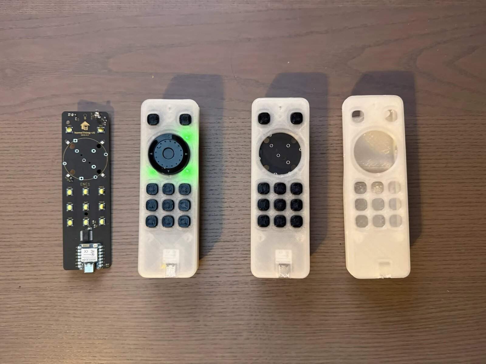

## What homeThing C6 does

- **Runs your TV.** It learns the IR codes from the remote you already have. Then the wheel and pad drive the TV.
- **Switches the lights.** A button talks straight to Zigbee lights and groups.
- **Any button, any device.** Each button can drive something different, for example a gas fireplace over Zigbee.
- **Sleeps on its own.** It sleeps between presses, with a target of about a month per charge.
- **No hub needed.** Presses go straight to your Zigbee lights and IR devices. They work without Wi-Fi, Home Assistant, or Zigbee2MQTT.
- **No flashing needed.** Set every button from the remote's own web page, in any browser. You do not edit YAML or rebuild the firmware.
- **Bluetooth keys too.** Pair it like a Bluetooth keyboard or gamepad, and send media keys to a computer, phone, or tablet.
- **Open source, all of it.** The board, the case, and the ESPHome firmware are in this repository.

## Specs

### One remote, no screen.

| Spec | Detail |
| --- | --- |
| **Controls** | Scroll wheel with 5-way pad, 11 assignable buttons |
| **Battery** | 1000 mAh LiPo, with a target of about a month per charge |
| **Charging** | USB-C |
| **Processor** | Seeed Studio XIAO ESP32-C6 |
| **Infrared** | Transmits, receives, and learns codes |
| **Voice** | Microphone for the Home Assistant voice assistant |
| **Status** | 4 RGB LEDs |
| **Case** | 3D printed, SLS or FDM |
| **Wireless** | Wi-Fi, BLE, Zigbee |

  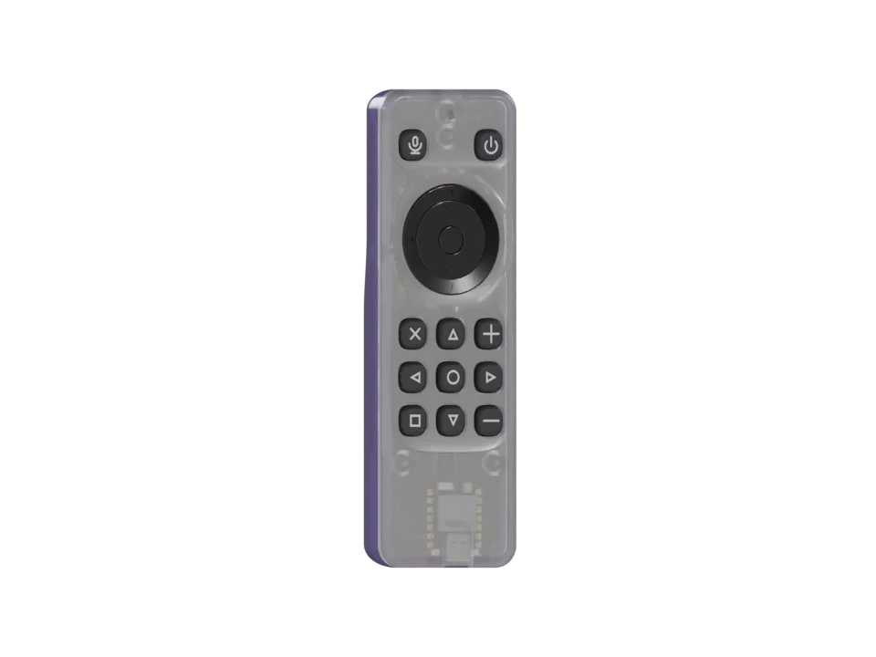

## Build one, or get one ready to go

The board arrives fully assembled, so there is no soldering. The board design, the firmware, and the case files are all open source in this repository, so you can build your own from scratch.

- **Case:** The [`case/` README](case/README.md) documents the enclosure files and assembly information.
- **Board:** The [`c6remote-kicad/` README](c6remote-kicad/README.md) documents the KiCad hardware source.
- **Firmware:** The [Make It Yours](#make-it-yours) section documents button assignment. [`c6remote.yaml`](c6remote.yaml) is the ESPHome configuration.
- **Scripts:** The [`scripts/` README](scripts/README.md) documents project utilities and generated assets.

## Your smart home, on real buttons

### Control Anything

Pick it up, press a button, and the lights change. No phone to unlock, no app to open.

- **TV:** Learns the IR codes from the remote you already have, then sends them.
- **Music:** Controls Sonos over Wi-Fi, or pairs with a phone, tablet, or computer over BLE for media keys.
- **Lights:** Talks straight to Zigbee lights and groups.
- **Home Assistant:** Puts any action or script on a button.
- **Voice:** Talks to your Home Assistant voice assistant through the built-in mic.

  <picture>
    <source media="(prefers-color-scheme: dark)" srcset="docs/readme-assets/remote-controls-annotated-dark.svg">
    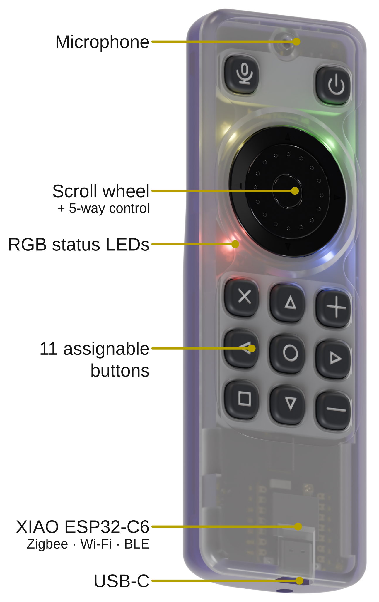
  </picture>
  <picture>
    <source media="(prefers-color-scheme: dark)" srcset="docs/readme-assets/remote-back-annotated-dark.svg">
    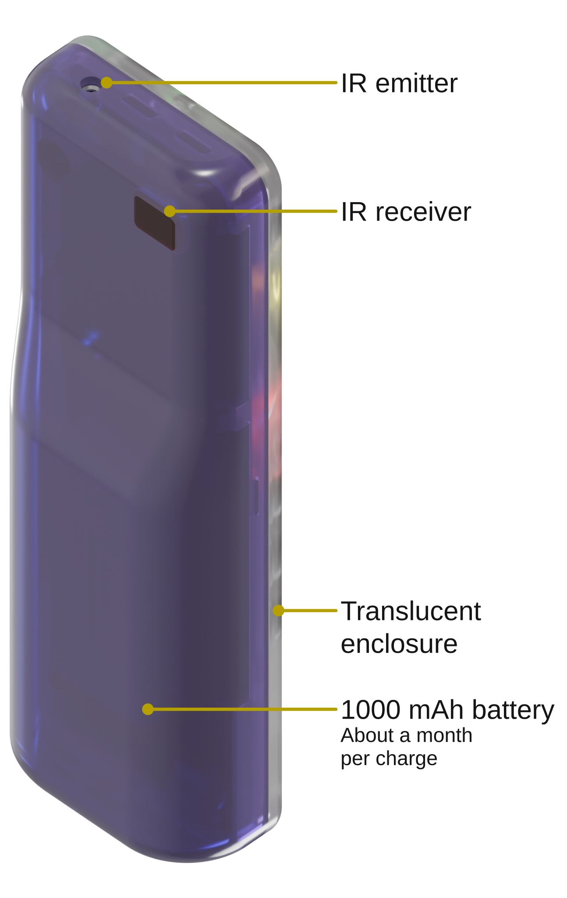
  </picture>

## Make It Yours

### Every button is yours to set.

Open the remote's own web page from any browser on your network. Pick a button, then pick what it does: an IR code, a Zigbee light or group, a BLE media key, a Home Assistant action, or voice. You can also assign buttons on the remote itself. No app, no cloud.

#### Button assignment ([more info](RECEIVER.md))

Open `http://homething-c6-xxxxxx.local/` in a browser. `xxxxxx` is the end of the remote's MAC address.
Home Assistant also shows this address as the **Web Page** entity.
To assign buttons on the remote itself, hold `SW9` for two seconds.
[`RECEIVER.md`](RECEIVER.md) has the full steps.
The page has no password, so use it only on a trusted network.

  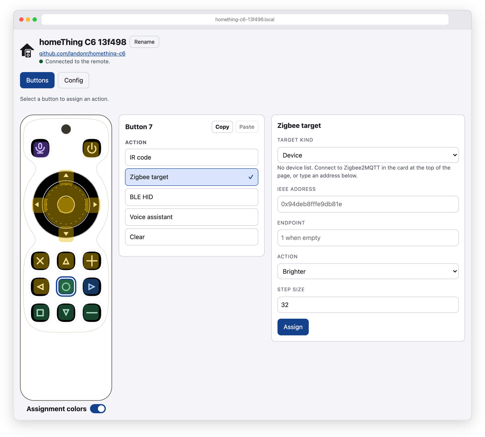
  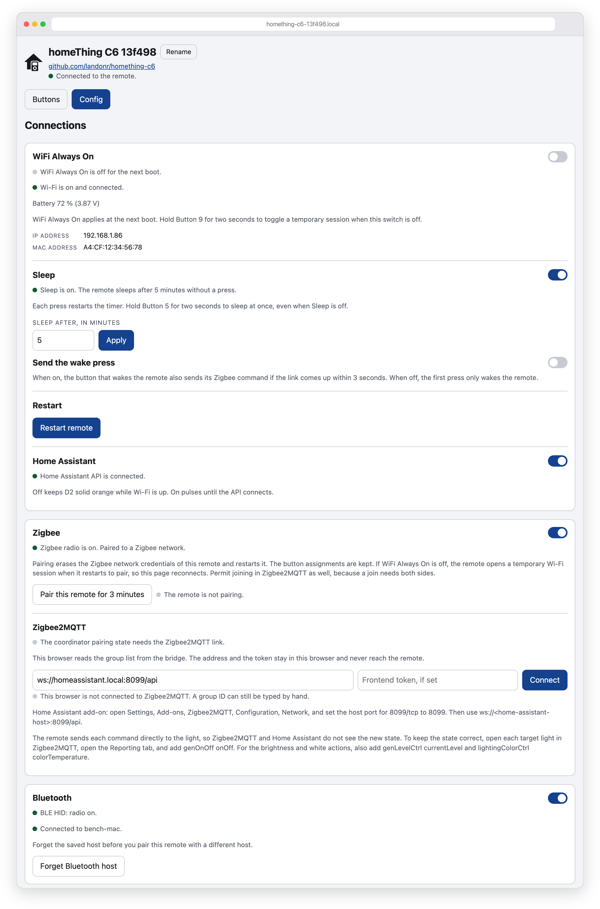

The Buttons tab with a Zigbee assignment, and the Config tab

## Built Your Way

### A custom board in an open case.

- Custom PCB built around the Seeed Studio XIAO ESP32-C6.
- Parametric 3D printed case in SLS and FDM versions.
- Sleeps between presses and wakes on any button.

### Case ([more info](case/README.md))

  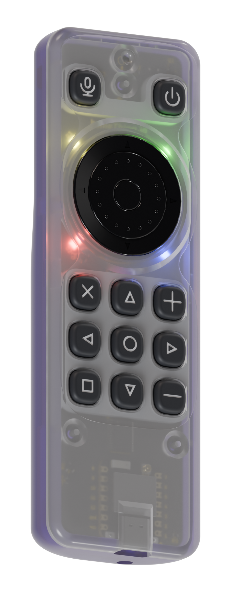
  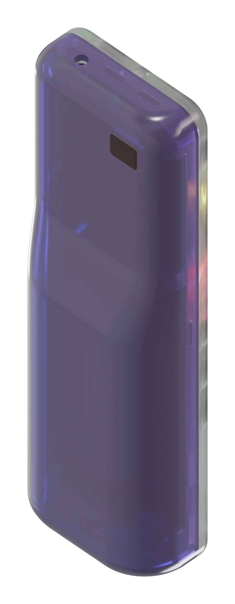

  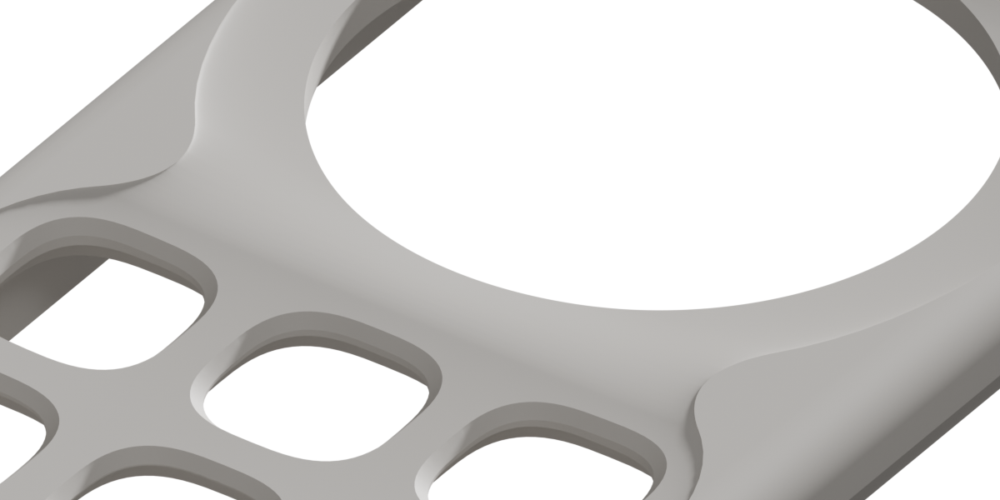
  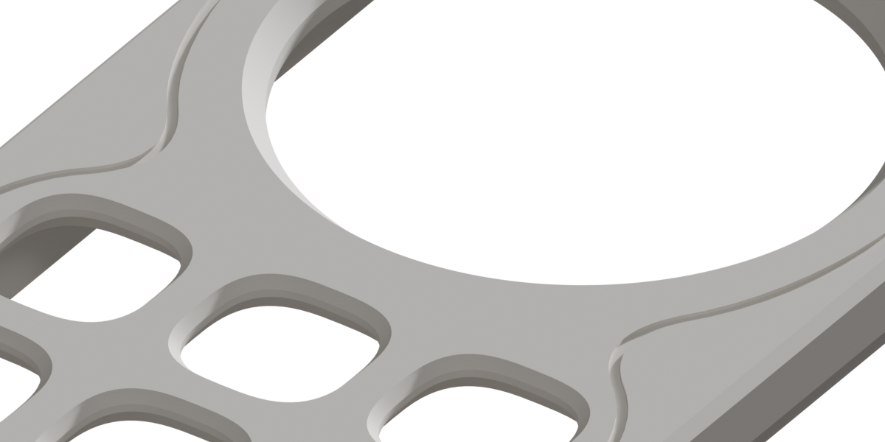

SLS front and FDM front

### Board ([more info](c6remote-kicad/README.md))

  <picture>
    <source media="(prefers-color-scheme: dark)" srcset="docs/readme-assets/board-front-annotated-dark.svg">
    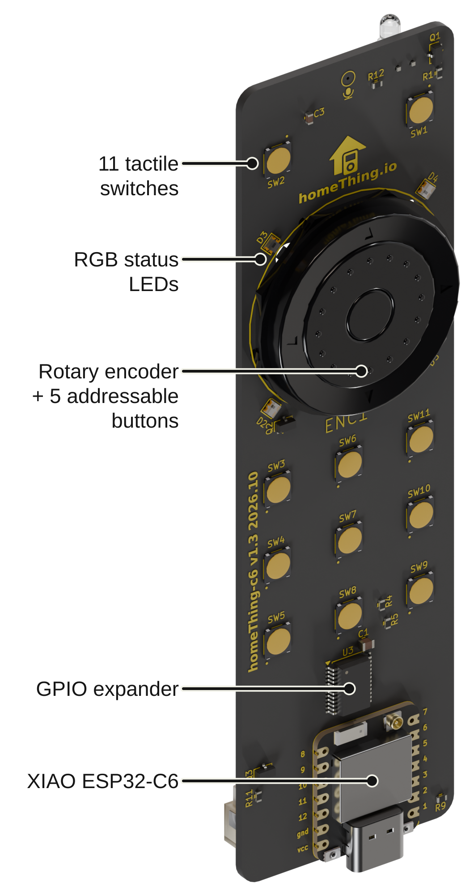
  </picture>
  <picture>
    <source media="(prefers-color-scheme: dark)" srcset="docs/readme-assets/board-back-annotated-dark.svg">
    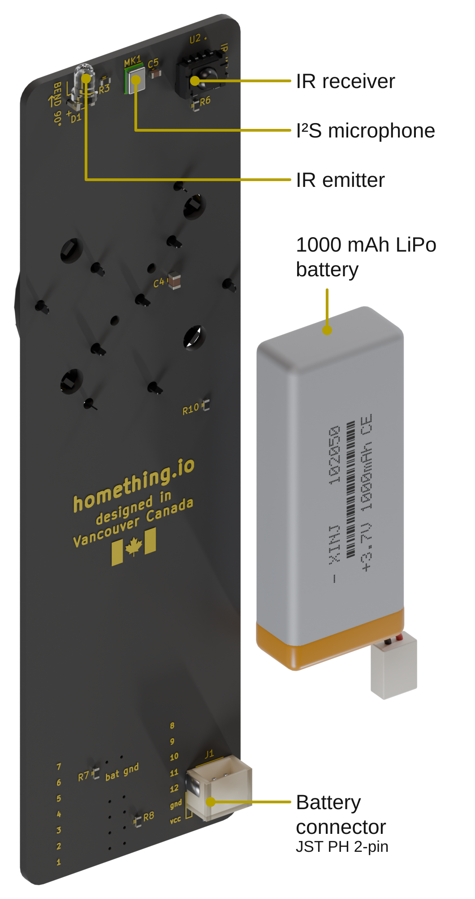
  </picture>

PCB front and back

  
  

Copper top and bottom

| Ref | Part | Role |
| --- | --- | --- |
| `U1` | [Seeed Studio XIAO ESP32-C6](https://mm.digikey.com/Volume0/opasdata/d220001/medias/docus/8932/102010636.pdf) | Main module: Wi-Fi, BLE, Zigbee/Thread |
| `MK1` | [DMM-4026-B-I2S-R I2S microphone](https://api.puiaudio.com/filename/DMM-4026-B-I2S-R.pdf) | Audio input: PUI Audio bottom-port MEMS part on the back copper, hearing through a 0.5mm NPTH. `LR` and `CONFIG` tie to ground for left-channel output, `C5` decouples VDD and `R12` pulls `sd` down. It replaced the ICS-43434 on 2026-09-07, after three of the five rev-B microphones failed |
| `U2` | [TSOP6136 IR receiver](https://www.vishay.com/docs/82457/tsop61.pdf) | IR receive: Vishay Panhead SMD part on the back copper, listening out the top end wall. AGC1, the most permissive of Vishay's settings, which is what lets `remote_receiver` learn arbitrary remotes. VDD sits on the switched `ir_vdd` rail rather than straight on `+3.3V`, gated by `Q3` below |
| `D1`, `Q1` | [INL-3AHIR30 IR LED](http://www.inolux-corp.com/datasheet/IR/Emitter/3mm%20Lamp/INL-3AHIR30_V1.0.pdf) driven by [MMBT2222A](https://assets.nexperia.com/documents/data-sheet/MMBT2222A.pdf) | IR transmit; D1 leads hand-bent 90° to fire through the top-edge notch (see `BEND 90°` silk mark) |
| `U3` | [PCF8575DBR I2C GPIO expander](https://www.ti.com/lit/ds/symlink/pcf8575.pdf) | Button input fan-out |
| `SW1`–`SW11` | [TL3315NF160Q tactile switches](https://www.e-switch.com/wp-content/uploads/2022/06/TL3315.pdf) | Discrete buttons |
| `ENC1` | [Adafruit ANO rotary encoder](https://cdn-learn.adafruit.com/assets/assets/000/104/942/original/tsw.pdf) | Scroll wheel: encoder channels plus five switch signals |
| `D2`–`D5` | [XL-2020RGBC-WS2812B addressable LEDs](https://mm.digikey.com/Volume0/opasdata/d220001/medias/docus/8903/5962_XL-2020RGBC-WS2812B.pdf) | Status light chain of 4, WS2812B protocol: `GPIO17` drives `D2` DIN, DOUT cascades to `D5`. VDD sits on the switched `led_vdd` rail rather than straight on `+3.3V`, gated by `Q2` below, with `C4` as the only bulk cap on the chain (see [`docs/timeline.md`](docs/timeline.md)) |
| `Q2`, `R10`, `C4` | [AO3401A P-channel MOSFET](https://www.aosmd.com/res/datasheets/AO3401A.pdf), 1M 0603 pull-up, 1µF X7R 0805 cap | LED rail load switch: high-side `Q2` gates `+3.3V` (source) onto `led_vdd` (drain) for `D2`–`D5`, gate net `led_en` on `U1` pad 11 (`GPIO18`/`D10`), driven low for rail on. `R10` pulls the gate to the source so the rail is off by default at boot while `GPIO18` floats as an input; `C4` is the mid-chain bulk cap on `led_vdd`. Cuts the ~2.0mA the LEDs burned when dark to tens of µA (calculated, not yet measured). Firmware must hold `GPIO17` low or high-impedance whenever the rail is down, or DIN pushes current into the dead rail |
| `J1` | [JST S2B-PH-SM4-TB(LF)(SN)](https://www.jst-mfg.com/product/pdf/eng/ePH.pdf) | Battery connector, PH series right-angle SMD |

The auto-generated BOM lives at [c6remote-kicad/export/c6remote-bom.csv](c6remote-kicad/export/c6remote-bom.csv). It tracks the latest repo state and is not release-validated.

#### Schematic

  <picture>
    <source media="(prefers-color-scheme: dark)" srcset="docs/readme-assets/schematic-dark.svg">
    
  </picture>

## Status ([more info](docs/timeline.md))

The fabrication and bring-up history, the rev-B delivery, and the unit 1 versus current design comparison are in [`docs/timeline.md`](docs/timeline.md). Open work is in [`ROADMAP.md`](ROADMAP.md). The power budget is in [`docs/power-budget.md`](docs/power-budget.md).

## Relationship to homeThing ([more info](https://github.com/landonr/homeThing))

This project grew out of [homeThing](https://github.com/landonr/homeThing) but has a narrower job: instead of a general smart display, it is a simple dedicated remote. It has no screen and more buttons, and is built on a custom PCB that is easy to build.

# Includes
- <a href="https://esphome.io/">ESPHome</a>
- <a href="https://dejavu-fonts.github.io/">DejaVu Sans Bold</a>, used for the board silkscreen brand text
- [@luar123](https://github.com/luar123)'s <a href="https://github.com/luar123/zigbee_esphome">Zigbee ESPHome component</a>
- <a href="https://www.kicad.org/">KiCad</a>
- <a href="https://github.com/landonr/homeThing">homeThing</a>

# Sponsorship

## [PCBWay](https://pcbway.com/g/Xymq6O "PCBWay") sponsors 3D Printing and PCB assembly costs on this project during the prototyping phase! 
If you are interested in their awesome fabrication services please check them out.&nbsp; They offer 

3D prototyping,&nbsp;PCB design and assembly, as well as CNC metal fabrication.&nbsp; Costs are reasonable and the quality is as good as it gets.&nbsp; Thank you PCBWay for sponsoring us and other fun projects!
