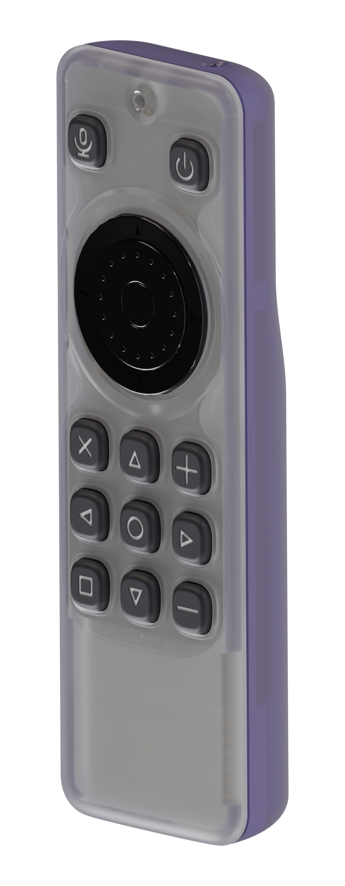
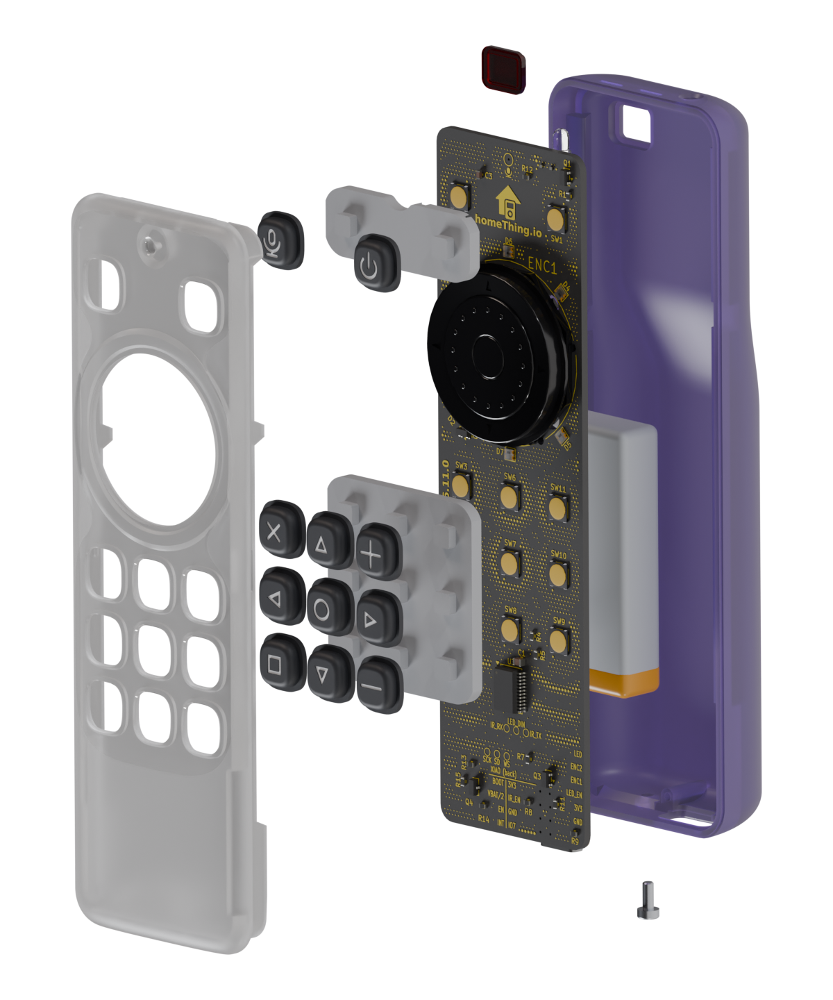
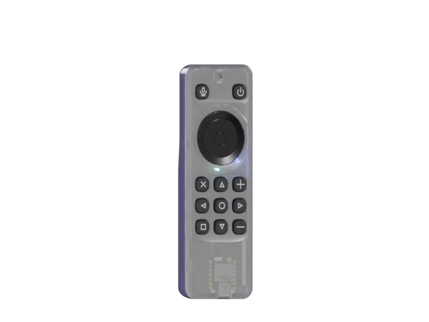
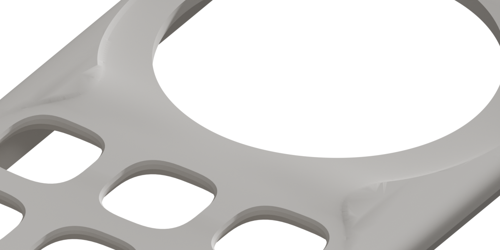
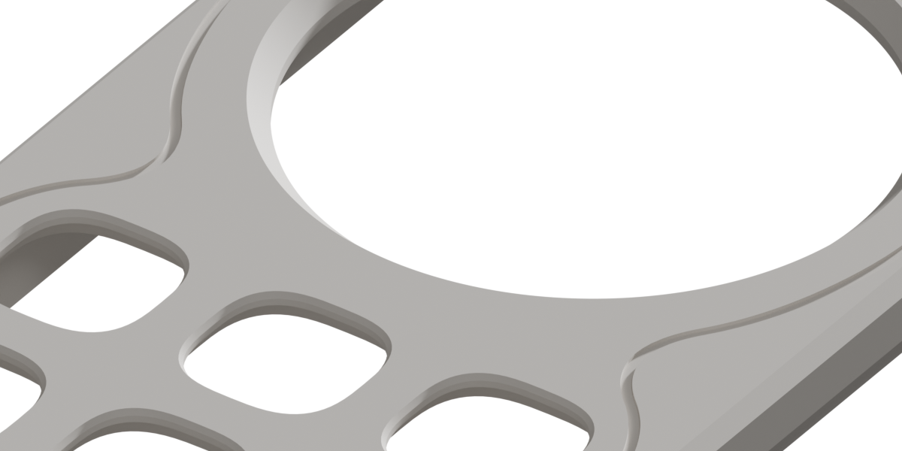
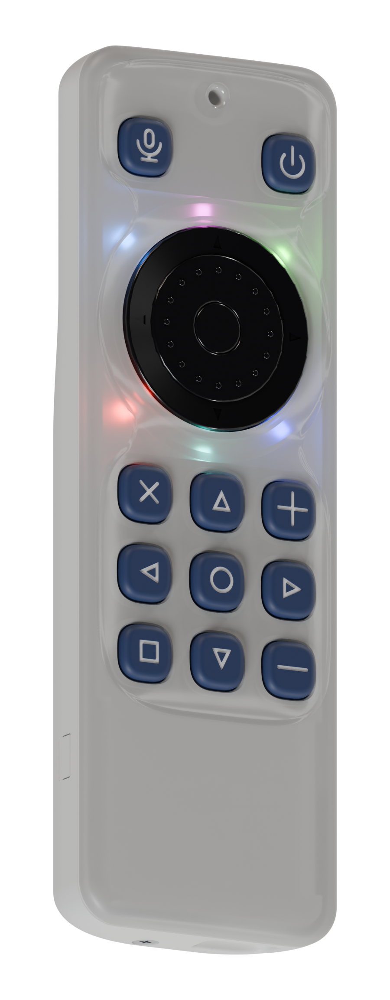

# Case

This directory contains the parametric enclosure model for the c6remote board.
The model uses [build123d](https://build123d.readthedocs.io/), so the source is Python.

<p align="center">
  
</p>
<p align="center"><sub>Assembled case</sub></p>

<p align="center">
  
</p>
<p align="center"><sub>Front shell, caps, button pad, board, and back shell</sub></p>

<p align="center">
  
</p>

The model exports a front shell, back shell, soft button pad, IR window insert, and 11 rigid caps. It also exports a blank version of each cap, `c6remote-cap-sw<n>-blank.stl`, with no legend.
It also exports an FDM button pad with all keytops and legends fused into one STL.
It also exports a second front shell for a filament printer. Read [SLS and FDM versions](#sls-and-fdm-versions).
It also exports the V2 top pads, an FDM one and a one-piece TPU one, for a V2 board. Read [V2 board](#v2-board).
It also exports the end-wall screw, `c6remote-case-screw.stl`, in its installed position. Buy this screw. Do not print it. Read [Parts](#parts).

## SLS and FDM versions

<p align="center">
  
  
</p>
<p align="center"><sub>On the SLS face (left), the shading is darker where the face or the dish is steeper. The arched face and the basins show without contour lines. The FDM face (right) is flat, with an outline groove and a chamfered edge.</sub></p>

<p align="center">
  
  
</p>
<p align="center"><sub>SLS front (left) and FDM front (right), isometric</sub></p>

Both versions use the same back shell, IR window, interior, and board position. Only the front face and the button pad change.

| | SLS | FDM |
| --- | --- | --- |
| Front shell | `c6remote-case-front.stl` | `c6remote-case-front-fdm.stl` |
| Face | A shallow dish around the keys and the wheel | One flat plane. The dish outline is a shallow groove. |
| Face height | Base level | `FDM_FACE_DROP` lower |
| Top edge | None. The face rolls down into every wall. | 45 degree chamfer, `EDGE_R_FRONT_FDM` |
| LED ring channel | Full depth, with an even roof under the face | Half the arch depth, for a thicker roof |
| Button pad | `c6remote-case-pad-tpu.stl` in one piece, or `c6remote-case-pad.stl` with the 11 caps | `c6remote-case-pad-fdm.stl`, with the keytops fused to the lobes |
| Pad web | Plain | Isolation grooves, `FDM_PAD_GROOVE_W` wide |
| Print | SLS. A filament printer must support the dish floor, and the support marks the face. | Filament, face down. The face needs no support. |
| Assembly | Install the caps before the pad. The one-piece TPU pad has no caps. | Install the pad from inside, before the board |

Read [FDM front](#fdm-front) for the FDM face details.

## Setup

Run these commands from the repository root:

```bash
cd case
uv venv --python 3.12 .venv
uv pip install --python .venv/bin/python -r requirements.txt
```

## Build and validate

Run these commands from the repository root:

```bash
scripts/export-case-refs.sh
case/.venv/bin/python case/board.py
case/.venv/bin/python case/case.py
case/.venv/bin/python case/check.py
```

Use a scoped check during development:

```bash
case/.venv/bin/python case/check.py --only ir
case/.venv/bin/python case/check.py --only support,shells
```

Run the full check before you accept a case change. A scoped check does not validate the full model.

Run independent feature groups in parallel when two or more groups are selected:

```bash
case/.venv/bin/python case/check.py --jobs 4
case/.venv/bin/python case/check.py --only ir,support --jobs 2
```

Use `--quiet` for failures, provenance, counts, and the scoped-run warning. Use `--timings` to print pass durations.

Every run also writes `export/c6remote-checks.json`: the same report in machine form, with each failure's own point or box in the case frame where the pass recorded one. Use `--json PATH` to write it somewhere else. The c6remote-explode viewer reads that file and draws the failures on the model, so a scoped run writes only the features it ran and marks itself scoped.

A pass says where a failure is by appending a `checks.common.Problem` instead of a plain string; a plain string still reports, it just cannot be drawn.

Use this command to preview the model:

```bash
case/.venv/bin/python case/case.py --show
```

The preview requires `ocp-vscode`:

```bash
uv pip install --python case/.venv/bin/python ocp-vscode
```

Without `ocp-vscode`, use the exploded viewer instead:

```bash
../c6remote-explode/preview-case.sh
```

That script lives in the viewer checkout. It builds the STL files, copies them into the viewer's draft geometry set, and opens the viewer.
It omits the feature map and the summary, so a draft build takes about 6 seconds on a warm cache.

## Board inputs

Do not copy a board coordinate into the case model. Add a reader to `board.py` instead.

The model reads these sources:

- `c6remote-kicad/c6remote.kicad_pcb` supplies the outline, courtyards, wheel center, and microphone port.
- `c6remote-kicad/export/c6remote-pos.csv` supplies component positions.
- `case/board/c6remote-board.step` supplies component bodies, keepout heights, and connector geometry.
- `case/board/c6remote-board-only.step` supplies the board solid.
- `case/board/c6remote-outline.dxf` supplies the exported outline.
- `case/board/c6remote-v2-board-only.step` supplies the fixed V2 outline, which guards the shared frame.
- `case/board/c6remote-v2-pos.csv` supplies the fixed V2 switch positions.

Run `scripts/export-case-refs.sh` after a relevant schematic or board change. Then build and run the full check.

`scripts/export-case-refs.sh` needs the KiCad 3D models for the component bodies in `case/board/c6remote-board.step`. The models are in the private `c6remote-explode` repository.

Run `scripts/link-3dmodels.sh` once for each clone or worktree to link the models. If a model is missing, `scripts/export-case-refs.sh` stops and names the file.

Do not regenerate `case/board/c6remote-v2-board-only.step` or `case/board/c6remote-v2-pos.csv`. Both are static references from release `2026.8.0`, commit `d0a2c2e`.

## Coordinate frame

The X axis is the KiCad board X axis. The Y axis is the negative KiCad board Y axis.

The Z origin is the bottom face of the board. Positive Z points toward the front shell.

The position CSV already contains the negative Y coordinates. Do not apply a second Y transformation.

## Parameters

Put all adjustable geometry values in `params.py`. Give each value a short rationale in its docstring.

The model derives geometry from the board where possible. Manual values include switch travel, switch height, print fits, and material thicknesses.

`SWITCH_HEIGHT` and `SWITCH_TRAVEL` are not measurements. Measure a physical TL3315 before the first production print.

## Materials

Print the shells with a tinted translucent filament. The STL files contain no color or material data.

A white filament also works. The roof over the LED ring channel is `LED_RING_FACE_ROOF` thick under the face, so the status LEDs glow through a white front.

<p align="center">
  
</p>
<p align="center"><sub>White front with the status LEDs on</sub></p>

A white shell scatters the light inside the plastic, so the roof thickness sets how much LED light gets through.

The IR window material must transmit 940 nm infrared light. Test the selected filament with a physical remote.

If the shell filament blocks too much infrared light, make the same insert from IR-pass acrylic.

Prototype the button pad in TPU. Use translucent silicone for a molded part.
The molded pad has a skirt on the outer edge of each lobe. The skirt is `PAD_SKIRT_T` wide and its bottom is level with the plunger contacts, so the pad stands level on the plungers and the skirt.
The skirt has a break over each board part that it would otherwise touch. `PAD_SKIRT_CLEARANCE` sets the gap.
The molded pad and the one-piece TPU pad have a plain web without isolation grooves. Only the FDM pad has grooves.

`c6remote-case-pad-tpu.stl` goes with the recessed front `c6remote-case-front.stl`. Print it in TPU as one piece in place of the TPU pad and the PETG caps. Do not install separate caps with it.

For keytops with no legend, print `c6remote-case-pad-tpu-blank.stl` in place of `c6remote-case-pad-tpu.stl`.
It is the FDM pad with the same skirt as the molded pad. It has no edge chamfer, because TPU flexes on its own. Its grid web is a plain slab with square edges.

Print the caps in translucent PETG or PLA. Either orientation works. For a key with no legend, print `c6remote-cap-sw<n>-blank.stl` in place of `c6remote-cap-sw<n>.stl`. The blank cap has the same fit.

The cap flange rests on the pad web, so a press moves the cap and the web together. `CAP_LIFT` sets any air under the flange.

Top faces against the build plate gives the best finish. Top faces up needs support on the top faces. Trim the support marks after the print.

For a rigid FDM button set, print `c6remote-case-pad-fdm.stl`. It includes the
two pad lobes and all 11 keytops in one STL. Each keytop is flush with its lobe
web. Do not install separate caps with it.

Print the FDM pad in either orientation. The STL exports with the keytops up.

Keytops down puts the keytop faces on the plate. The pad then stands on 523 mm2.

Keytops up puts the pad on the keytop stems. The pad then stands on 26 mm2. Use a brim and a clean plate. Set the support roof density to 80 percent, or the web sags into the support. Trim the support marks after the print.

The FDM pad cuts its isolation grooves from the keytop side only. As a result, the web underside is flat, and the supports for a keytops-up print come off easily.

The chamfer on both lips of each groove and on the grid lobe outer top edge runs down to the groove floor, set by `FDM_PAD_GRID_CHAMFER`.

If you print keytops down, the grooves face the support. Then the supports fill the grooves and are hard to remove.

## FDM front

The export contains two front shells. Both shells have the same interior, so the caps, the pad, and the back shell fit either one.

`c6remote-case-front.stl` is the recessed front. Its face carries a shallow dish around the keys and around the wheel.

The recessed front's face is one superellipse across its width, from side wall to side wall. `FACE_POWER` is its exponent. The crown runs along the centreline, `FACE_CROWN_OVER_WHEEL` above the knob's measured top. The face falls `FACE_SIDE_DROP` from the crown to each side wall and meets the wall vertically. No edge shows where a flat panel turns into a round.

Over `FACE_END_ROLL` from each end wall, the face rolls down into the end wall with the same exponent. Around the plan corners, the section follows the corner arc. As a result, the face meets every wall vertically at one height, `FACE_WALL_TOP`.

`face_z()` states the face. `face_body()` builds a spline fit to it, and the build stops if the fit strays past `FACE_FIT_TOLERANCE`.

Every dish follows the face, so the bore rim is lower at the east and west sides of the knob. The thumb can then reach more of the knob there.

The LED ring channel ceiling keeps a vertical roof of `LED_RING_FACE_ROOF` under the built face all the way round, so the six LEDs glow through an even roof. `LED_RING_FACE_ROOF` is the minimum wall that PCBWay publishes for SLA resin. The ceiling does not drop below a circular arch, `LED_RING_ROOF` below the crown and `LED_RING_SAG` lower at each side wall. `LED_RING_SAG` keeps the arch below the ceiling at the east and west sides of the knob, where the face is lowest. As a result, the channel is shallowest there. The ring roof check holds the roof above its floor.

The outer wall of the channel is plumb at the mouth, then rakes in at 45 degrees up to the ceiling. The rake ends where a 45 degree line from the mouth meets the arch. Where the ceiling is above the arch, the rake starts higher at the mouth, so the roof flat does not get narrower. The inner bevel, `LED_RING_INNER_CHAMFER`, hangs from the local ceiling. Where the channel is too shallow for the full bevel, at the east and west sides, the bevel shortens and keeps `LED_RING_INNER_FOOT_MIN` of upright inner wall. The FDM front's channel depth comes from the arch, so `LED_RING_FACE_ROOF` does not change the FDM front.

A chamfer, `RECESS_CHAMFER_W` wide, runs round the whole recess inside the rim, between the face and the dish. In each section across the rim, a round leaves the face `RECESS_CHAMFER_ROUND_OUT` outside the rim with the face's own slope and runs `RECESS_CHAMFER_ROUND_W` inside it. Its start outside the rim gives it room to turn gently, and the face is cut there. A second round, `RECESS_CHAMFER_INNER_ROUND_W` wide, meets the dish floor with the floor's own slope. If the two rounds leave room, the section is straight between them. The two rounds fill the chamfer, so the section is one S-curve from the face to the dish. The chamfer replaces the soft roll that the dish had, so `WHEEL_RIM_SOFT`, `KEYPAD_RIM_SOFT` and `KEYPAD_RIM_SOFT_2` are zero. The rim outline does not move.

The floor does not rise across a neck. It runs flat from the key row nearest the wheel and then falls into the wheel basin. The plan outline of the neck does not change. The necks cross the LED ring channel north and south of the knob, so the ring roof check limits how deep they can go.

Each dish depth is measured down from the face, so the dish rim keeps its designed outline. The face falls toward the side walls, so it lowers the dish floor under the outer edge of each outer-column key. In the key dishes, `KEYPAD_LIP_LIFT` gives part of that drop back, so the floor rises to a crest before the rim. The counterbore lands there are the thinnest. The counterbore lands limit how deep `KEYPAD_DISH_DEPTH` and `KEYPAD_DISH_DEPTH_2` can go.

Each cap top is flat and stands `CAP_PROTRUSION` above the face at the cap's centre. The caps in the outer columns stand lower than the caps on the centreline. Each stem stops at its own cap's socket ceiling.

`c6remote-case-front-fdm.stl` is the FDM front. Its face is one flat plane and carries the same dish outline as a shallow groove. It does not roll into the walls.

Use `c6remote-case-pad-fdm.stl` with this front. The keytops have no captive
flanges, so install this pad from inside before the board. The face holes guide
the integrated keytops with `FDM_CAP_GUIDE_CLEARANCE` on each side.

Print a front shell with its face against the build plate. A filament printer cannot make the dish in this orientation.

The dish floor is a wide, almost horizontal ceiling a fraction of a millimetre above the plate. The printer must support it.

Support under the face marks the one cosmetic surface on the case. The other orientation stands the whole cavity on its ceiling.

The groove is narrow, so the layer above it bridges the gap in one span. The FDM front needs no support on its face.

The FDM front's face sits `FDM_FACE_DROP` below the recessed front's crown, so the part is slimmer than a flat face at the raised level.

On the FDM front, the caps and the wheel stand that much higher above the face than on the recessed front. The recessed front stands its caps proud of the dish by `CAP_PROTRUSION` plus the local dish depth. The recessed front's crown stands `FACE_CROWN_OVER_WHEEL` above the knob top.

The drop thins the ceilings that the dish never reaches. Run `check.py --only fdm` to check their thickness.

The groove follows the dish rim exactly. The outline on the two fronts is the same line.

The FDM front has a 45 degree top-edge chamfer, `EDGE_R_FRONT_FDM`. The recessed front's face rolls into the walls instead.

On the recessed front, the rim runs where the face already turns down toward the side walls. The FDM front keeps its groove on flat face outside the chamfer.

`FDM_FACE_DROP`, `FDM_OUTLINE_W`, `FDM_OUTLINE_DEPTH`, `FDM_OUTLINE_EDGE_CLEAR`, and `EDGE_R_FRONT_FDM` set the face. On this front the LED ring channel is `FDM_LED_RING_DEPTH_RATIO` of the recessed front's arch depth, so the roof is thicker and prints. Run `check.py --only fdm` to validate it.

## Parts

Buy these parts in addition to the board and the printed parts.

| Part | Specification | Qty | Use |
| --- | --- | --- | --- |
| End-wall screw | M2 x 5 pan head Phillips screw, ISO 7045 (DIN 7985 H), A2 or 18-8 stainless steel. [Westfield Fasteners](https://www.westfieldfasteners.co.uk/A2-ScrewBolt-PhilRaPan-M2.html) | 1 | Closes the shells at the grip end |
| Battery | 102050 LiPo pouch cell, single cell, 1000 mAh | 1 | Supplies power to the board |
| Battery plug housing | Molex PicoBlade `51021-0200` | 1 | Mates with `J1` |
| Battery plug terminals | Molex PicoBlade `50079-8000` crimp terminals | 2 | Go in the plug housing |
| Battery strips | Stretch-release adhesive strips | 2 | Hold the pouch cell on the back face of the board |
| IR window adhesive | Adhesive | As needed | Bonds the IR window flange to the shoulder in the back shell |

If the cell has a PicoBlade plug, do not buy the plug housing and the terminals. Make sure that the plug polarity agrees with the "+" mark on the board.

`c6remote-case-screw.stl` shows the screw in its installed position. Do not print it.

## Assembly

No screw holds the board. The cavity walls locate it, `BOARD_FIT` per side. The back shell support ledges carry it from below.
Two front-shell ledges near the grip end, one on each long side, hold it down from above. The microphone duct post also bears on the board top.
Each front ledge has a flat underside at the board top face, `FRONT_LEDGE_GAP` above it. Its face toward the ceiling slopes back into the wall at `SUPPORT_UNDER_ANGLE`, so it prints face down without support.
The ledge breaks come from the board top courtyards, the solids that rise above the board, and the V2 part bodies. `FRONT_LEDGE_REACH` limits them to the grip end, short of the button pad.

The back lap closes over the front skirt. Two detents secure the IR end.
Two hidden side catches keep the long seams closed near the board midpoint.
Their front-skirt pockets are blind, rounded, and bevelled at the mouth, with
continuous material behind them. The seam sits above the board top.
Each pocket sits a short lower lip above the front skirt's support relief, so a long solid skirt land stays above each catch.
The support relief stands `SUPPORT_SKIRT_FIT` above the ledge tops, so the front skirt never lands on a ledge. The seam shoulder is the only vertical stop.
A rectangular groove runs without a break round the outer top edge of the back lap. It makes the seam a deliberate shadow line, so a small step or gap between the shells does not show.
`SEAM_SHADOW_DEPTH` sets how far the groove cuts into the lap. `SEAM_SHADOW_H` sets how far it runs down from the seam.
Both fronts pair with the same back, so the groove is the same on both versions. The front shoulder bears on the lap top that remains and closes over the groove.
The lap behind the groove must keep `LAP_MIN_WALL`.
The back detents ramp on both sides so the shells can be opened for service.
Each back detent sits lower than its pocket and bears on the lower lip with a light preload.
The preload holds the seam closed.
`SIDE_CATCH_LOWER_LAND` sets the lower lip height, and `SIDE_CATCH_PRELOAD` sets the preload.

One M2 x 5 screw secures the grip end. It enters horizontally through the back shell's negative Y end wall and cuts its own thread in a block behind the front skirt.

If you install the screw again, turn it counterclockwise until it drops into its thread. Then turn it clockwise and tighten it lightly, so that it does not cut a new thread.

The negative Y end wall has a pocket for the USB cable boot outside the USB opening. A boot larger than the pocket cannot enter, so its plug does not seat. Verify plug seating on the first print.

The back shell has one pinhole near the USB-C port. A guide tube leads a straightened paper clip to the XIAO RESET button. Open the shell to reach BOOT.

On the first print, insert a straightened paper clip in the pinhole. Press gently and verify that the board restarts with power still connected.

The Qwiic opening has a flush cover with two breakaway bridges. The cover stays in place unless you need the port.

To open the port, remove the cover before you install the board. Break both bridges carefully and trim any nubs that obstruct the plug. Do not press on the connector.

Prepare the back shell first:

1. Insert the IR window from inside the back shell.
2. Make the pane flush with the outside surface.
3. Apply adhesive to the continuous shoulder below the interior flange.
4. Let the adhesive set.

Prepare the battery before shell assembly. Use the PicoBlade plug for J1. The model reserves a wire path from the connector, but does not measure the mating plug. Verify the plug and wire fit on the first print. Stretch-release adhesive strips hold the pouch cell:

1. Stick two stretch-release adhesive strips to the pouch.
2. Put the pouch on the back face of the board in the cell position, with its leads toward J1.
3. Keep the pull tabs free at the grip end.
4. Connect the plug to J1.

To remove the battery, pull each tab slowly along the board.

Assemble the remaining parts with the front face down:

1. Install all caps in the front shell.
2. Install the button pad.
3. Put the board in the front shell, with its top face on the front ledges and the microphone duct post.
4. Push the battery plug into J1.
5. Engage the two IR-end detents.
6. Fold the back shell onto the front shell.
7. Install the end-wall M2 screw at the grip end.

Install the caps before the pad. The caps are captive after pad installation.

For the FDM pad, omit step 1 and install `c6remote-case-pad-fdm.stl` in step 2.

Install the IR window before shell assembly. Its flange is not accessible after shell assembly.

## V2 board

The case is for the current board. A V2 board has different IR parts, connectors, and XIAO placement. Its USB connector does not align with the opening. Its fit in these shells is not verified.

The V2 pad models place SW1 and SW2 for a board at `SUPPORT_GAP` below the current board. Their fit does not establish compatibility with the shells.

For a V2 board, print `c6remote-case-pad-fdm-v2-top.stl`. Use it in place of the SW1 and SW2 lobe of `c6remote-case-pad-fdm.stl`.

The V2 top pad keeps the V3 SW1 and SW2 plungers. It adds one nib above each V2 switch.

Each nib extends `LEGACY_NIB_EXTENSION` below the V2 switch top. The kept V3 plungers use the same extension below the V3 switch top, so they stop above the nibs.

The SW1 and SW2 keytops of the V2 top pad stand level with the other keys.

Use the V2 top pad only with a V2 board. On a V3 board, the nibs land on the V3 switch bodies.

For the one-piece TPU pad on a V2 board, print `c6remote-case-pad-tpu-v2-top.stl`. On a V2 board, it replaces the SW1 and SW2 lobe of `c6remote-case-pad-tpu.stl`. Use it with the recessed front `c6remote-case-front.stl`.

`c6remote-case-pad-tpu-v2-blank.stl` is a complete V2 pad with blank keytops in one STL. Print it alone, with the recessed front `c6remote-case-front.stl`.

Its skirt ends level with the skirt of `c6remote-case-pad-tpu.stl`, so both lobes stand on one plane. Its skirt breaks come from the V3 part bodies, moved to the V2 placements.

For the moulded pad with separate caps on a V2 board, print `c6remote-case-pad-v2-top.stl`. Use it in place of the SW1 and SW2 lobe of `c6remote-case-pad.stl`, with the standard caps and the recessed front `c6remote-case-front.stl`. Its stems stay at the V3 SW1 and SW2 positions, so the standard caps fit it unchanged.

Print the FDM V2 top pad with the keytops down. The nibs extend below the plungers, so the part cannot stand level on its plungers.

On the first print, make sure that SW1 and SW2 operate and do not bind. Each V3 plunger overlaps the edge of a V2 switch body.

`SWITCH_HEIGHT` is also not a measurement, so the nib engagement is not confirmed.

## IR openings

`U2` receives infrared light through the back face along negative Z. Its opening includes the receiver body and lead envelope.

The IR window insert enters this opening from inside. Its exterior pane must be flush with the back shell.

`D1` emits through a separate bore in the positive Y end wall. A 45 degree chamfer clears the 15 degree half-intensity angle on each side of the emitter axis.

## Functional constraints

- Keep the button caps captive behind the front-shell ceiling.
- Keep the button pad clear of the wheel and the six wheel LEDs.
- Keep the pad skirt clear of board parts.
- Keep the LED ring channel open below its translucent roof.
- Keep the microphone funnel aligned with the board port. Its mouth must meet the recess floor in one edge all the way round.
- Keep the USB slot clear of the connector shell.
- Keep the USB boot pocket clear, with its floor near enough to the receptacle for a standard plug to seat.
- Keep the Qwiic plug path clear after removal of the breakaway cover.
- Keep the battery plug and wire path clear of the case and cell.
- Keep support ledges clear of board parts, the end screw block, and the cell.
- Keep the front ledges clear of top parts, the button pad, and the caps.
- Keep the cell envelope clear of board parts and the end screw block.
- Keep the front skirt clear above the support ledge tops.
- Keep the end screw block clear of the back shell. Its web ties it to the end skirt and the side skirt at skirt height only.
- Keep the end screw head in its counterbore, below the outer surface of the back shell. Keep the screw tip inside the pilot.
- Keep the IR window shoulder continuous for adhesive.
- Keep the front and back shell mating volumes separate. The side catch preload is the only exception. The checks allow this overlap only at the lower pocket lip.

The checks must probe built geometry. A check must not only repeat the formula that creates the feature.

After a loft or sweep change, inspect the exported STL. A valid BREP can still produce a damaged mesh.

## Validation

`check.py` validates these groups:

- Apertures and end ports
- Button caps, legends, pad fit, and switch contact
- Wheel clearance and the LED light path
- Microphone and USB geometry
- IR receiver clearance and window installation
- Board support ledges, front ledges, the end screw, cell clearance, and the V2 top pad
- Shell mating, the seam shadow groove, and component interference
- FDM front face flatness, height, top edge round, and outline groove
- Solid validity and closed STL meshes

Run the full validation before export:

```bash
case/.venv/bin/python case/check.py
case/.venv/bin/python case/case.py
```

The model writes STLs and metadata to `case/export/`. `case.py` prints current dimensions and screw lengths.

If the exported assets change, push them into the external viewer:

```bash
../c6remote-explode/preview-case.sh --full
```

That script builds again on the warm cache and copies the result into the viewer's draft geometry set.
Its `--baseline` mode rebuilds the committed geometry that the viewer's diff view compares against.

## Development rules

Use the public build123d API. Do not use raw OCP objects unless build123d has no equivalent.

When you add a check, change a related parameter temporarily. Confirm that the new check fails with a useful message.

For a refactor, compare the full check output and exported artifact hashes before and after the change.

The STL cache absorbs one known nondeterministic tessellation result in the back shell. Use `CASE_NO_CACHE=1` only when necessary.

## Files

| Path | Purpose |
| --- | --- |
| `params.py` | All adjustable geometry values |
| `board.py` | Readers for KiCad and board export geometry |
| `case.py` | Thin build and export entry point |
| `check.py` | Thin validation entry point |
| `cache.py` | Geometry and STL cache |
| `model/` | Case feature builders and export metadata |
| `checks/` | Validation modules for built geometry |
| `fonts/` | Vendored legend font and license |
| `glyphs/` | SVG legend centerline strokes |
| `board/` | Generated board references and the fixed V2 reference |
| `export/` | Generated STLs and JSON metadata |
| `export/c6remote-case-screw.stl` | The end-wall screw in its installed position. Do not print it. |
