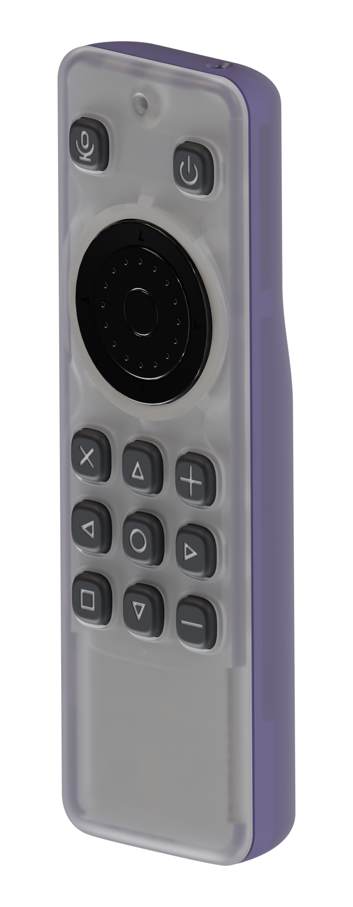
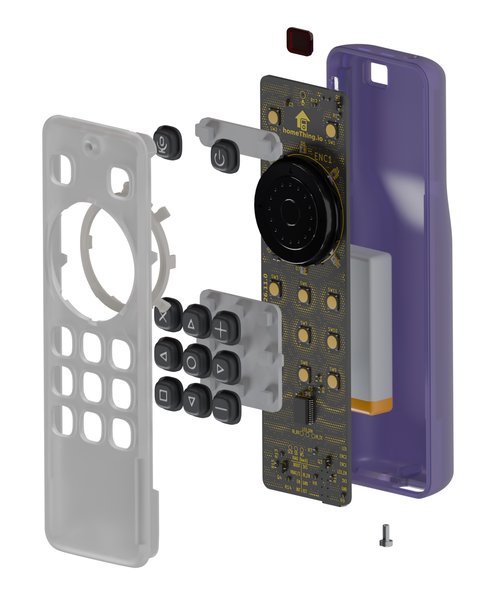
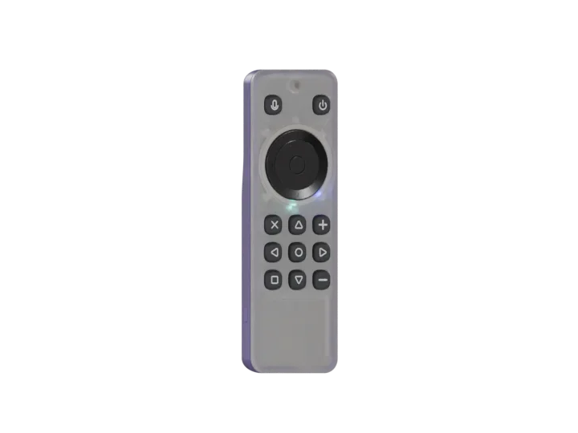
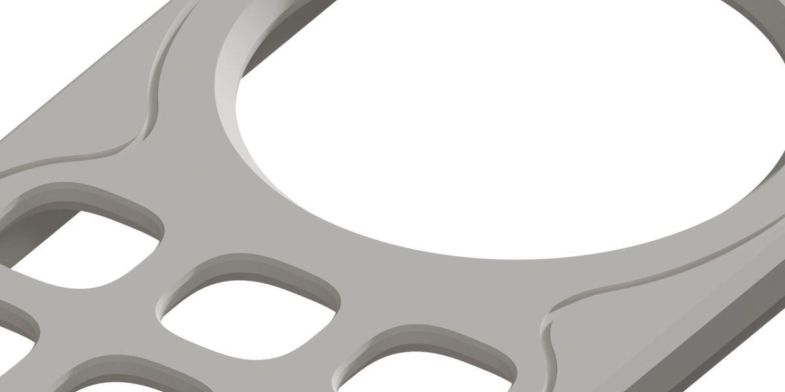
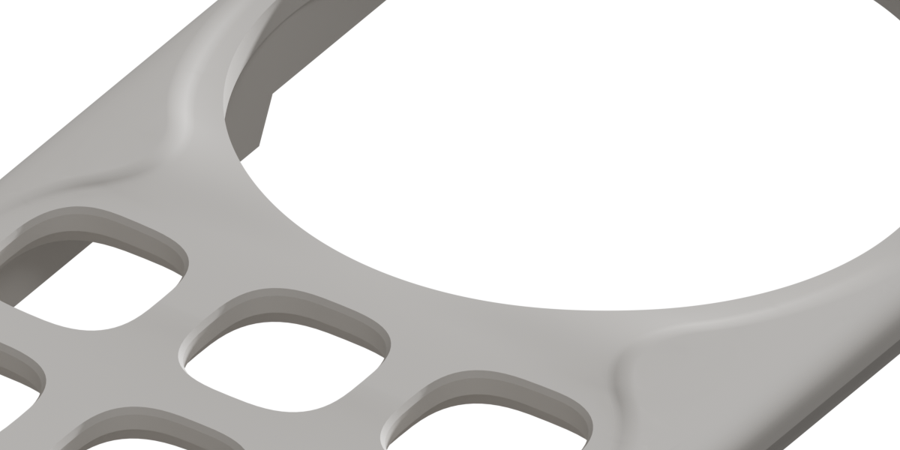
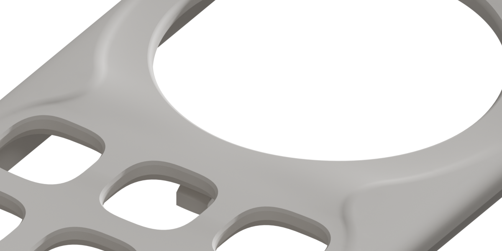
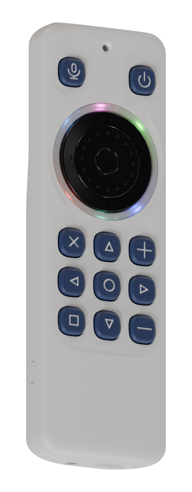

# Case

This directory contains the parametric enclosure model for the c6remote board.
The model uses [build123d](https://build123d.readthedocs.io/), so the source is Python.

<p align="center">
  
</p>
<p align="center"><sub>Assembled case</sub></p>

<p align="center">
  
</p>
<p align="center"><sub>Front shell, caps, button pad, board, and back shell</sub></p>

<p align="center">
  
</p>

The model exports the SLA front shell, back shell, soft button pad, IR window insert, LED ring insert, and 11 rigid caps. It also exports a blank version of each cap, `c6remote-cap-sw<n>-blank.stl`, with no legend.
It also exports an FDM button pad with all keytops and legends fused into one STL.
It also exports an FDM front shell for a filament printer. Read [Front versions](#front-versions).
It also exports an SLA one-piece front for a clear print, with the LED ring insert fused in. Read [SLA one-piece front](#sla-one-piece-front).
It also exports the V2 top pads, an FDM one and a one-piece TPU one, for a V2 board. Read [V2 board](#v2-board).
It also exports the end-wall screw, `c6remote-case-screw.stl`, in its installed position. Buy this screw. Do not print it. Read [Parts](#parts).

## Front versions

The case has three front versions:

- The FDM front prints on a filament printer. Its face is flat, with a groove on the dish outline.
- The SLA front is a Somos Taurus shell and a separate ring insert in UTR-8100. Its face has a shallow dish around the keys and the wheel.
- The SLA one-piece front is the SLA front with the ring insert fused in. It prints as one part in clear resin, so the whole front glows.

<p align="center">
  
  
  
</p>
<p align="center"><sub>FDM front (left), SLA front (middle), and SLA one-piece front (right), in plan. The FDM face is flat, with an outline groove and a chamfered edge. On the two SLA faces, the shading is darker where the face or the dish is steeper. The SLA face shows the joint line of the ring insert. The one-piece face has no joint line.</sub></p>

<p align="center">
  
  
  
</p>
<p align="center"><sub>FDM front (left), SLA front (middle), and SLA one-piece front (right), isometric</sub></p>

All three versions use the same back shell, IR window, interior, and board position. Only the face, the LED ring, and the button pad change.

| | FDM | SLA | SLA one-piece |
| --- | --- | --- | --- |
| Front shell | `c6remote-case-front-fdm.stl` | `c6remote-case-front.stl` and `c6remote-ring-insert.stl` | `c6remote-case-front-one-piece.stl` |
| Print | Filament, face down. The face needs no support. | SLA. A filament printer must support the dish floor, and the support marks the face. | SLA, as one part |
| Material | Filament | Somos Taurus for the shell. UTR-8100 in the translucent finish for the insert. | Clear resin. In UTR-8100, the translucent finish. |
| Face | One flat plane. The dish outline is a shallow groove. | A shallow dish around the keys and the wheel | The same as the SLA front |
| Face height | `FDM_FACE_DROP` lower | Base level | Base level |
| Top edge | 45 degree chamfer, `EDGE_R_FRONT_FDM` | None. The face rolls down into every wall. | None, as on the SLA front |
| LED ring | A channel at a fraction of the reference depth, under a roof of its own | One circle bored clear through the face. A separate insert fills it. | The insert is fused into the shell. The face over the ring has no joint line, and the whole front glows. |
| Button pad | `c6remote-case-pad-fdm.stl`, with the keytops fused to the lobes | `c6remote-case-pad-tpu.stl` in one piece, or `c6remote-case-pad.stl` with the 11 caps | The same as the SLA front |
| Pad web | Isolation grooves, `FDM_PAD_GROOVE_W` wide | Plain | Plain |
| Assembly | Install the pad from inside, before the board | Bond the insert. Install the caps before the pad. The one-piece TPU pad has no caps. | The same as the SLA front, but with no insert to bond |

Read [FDM front](#fdm-front) for the face details of the FDM and SLA fronts. Read [SLA one-piece front](#sla-one-piece-front) for the fused ring.

## Setup

Run these commands from the repository root:

```bash
cd case
uv venv --python 3.12 .venv
uv pip install --python .venv/bin/python -r requirements.txt
```

## Build and validate

Run these commands from the repository root:

```bash
scripts/export-case-refs.sh
case/.venv/bin/python case/board.py
case/.venv/bin/python case/case.py
case/.venv/bin/python case/check.py
```

Use a scoped check during development:

```bash
case/.venv/bin/python case/check.py --only ir
case/.venv/bin/python case/check.py --only support,shells
```

Run the full check before you accept a case change. A scoped check does not validate the full model.

A run spreads its passes across `--jobs` processes, which defaults to 10. The
suite is CPU-bound, so a serial run leaves a workstation idle. One pass,
`assembly.parts_are_sound`, takes about 10 minutes on its own and sets the
floor that no value gets under.

```bash
case/.venv/bin/python case/check.py --jobs 1   # serial
case/.venv/bin/python case/check.py --only ir,support
```

Use `--quiet` for failures, provenance, counts, and the scoped-run warning. Use `--timings` to print pass durations.

Every run also writes `export/c6remote-checks.json`: the same report in machine form, with each failure's own point or box in the case frame where the pass recorded one. Use `--json PATH` to write it somewhere else. The c6remote-explode viewer reads that file and draws the failures on the model, so a scoped run writes only the features it ran and marks itself scoped.

A pass says where a failure is by appending a `checks.common.Problem` instead of a plain string; a plain string still reports, it just cannot be drawn.

Use this command to preview the model:

```bash
case/.venv/bin/python case/case.py --show
```

The preview requires `ocp-vscode`:

```bash
uv pip install --python case/.venv/bin/python ocp-vscode
```

Without `ocp-vscode`, use the exploded viewer instead:

```bash
../c6remote-explode/preview-case.sh
```

That script lives in the viewer checkout. It builds the STL files, copies them into the viewer's draft geometry set, and opens the viewer.
It omits the feature map and the summary, so a draft build takes about 6 seconds on a warm cache.

## Board inputs

Do not copy a board coordinate into the case model. Add a reader to `board.py` instead.

The model reads these sources:

- `c6remote-kicad/c6remote.kicad_pcb` supplies the outline, courtyards, wheel center, and microphone port.
- `c6remote-kicad/export/c6remote-pos.csv` supplies component positions.
- `case/board/c6remote-board.step` supplies component bodies, keepout heights, and connector geometry.
- `case/board/c6remote-board-only.step` supplies the board solid.
- `case/board/c6remote-outline.dxf` supplies the exported outline.
- `case/board/c6remote-v2-board-only.step` supplies the fixed V2 outline, which guards the shared frame.
- `case/board/c6remote-v2-pos.csv` supplies the fixed V2 switch positions.

Run `scripts/export-case-refs.sh` after a relevant schematic or board change. Then build and run the full check.

`scripts/export-case-refs.sh` needs the KiCad 3D models for the component bodies in `case/board/c6remote-board.step`. The models are in the private `c6remote-explode` repository.

Run `scripts/link-3dmodels.sh` once for each clone or worktree to link the models. If a model is missing, `scripts/export-case-refs.sh` stops and names the file.

Do not regenerate `case/board/c6remote-v2-board-only.step` or `case/board/c6remote-v2-pos.csv`. Both are static references from release `2026.8.0`, commit `d0a2c2e`.

## Coordinate frame

The X axis is the KiCad board X axis. The Y axis is the negative KiCad board Y axis.

The Z origin is the bottom face of the board. Positive Z points toward the front shell.

The position CSV already contains the negative Y coordinates. Do not apply a second Y transformation.

## Parameters

Put all adjustable geometry values in `params.py`. Give each value a short rationale in its docstring.

The model derives geometry from the board where possible. Manual values include switch travel, switch height, print fits, and material thicknesses.

`SWITCH_HEIGHT` and `SWITCH_TRAVEL` are not measurements. Measure a physical TL3315 before the first production print.

## Materials

Print the shells in Somos Taurus by SLA. Taurus is an opaque, charcoal grey resin, so no light goes through the shell at any thickness. The STL files contain no color or material data.

The status LEDs do not shine through the front shell. They shine into `c6remote-ring-insert.stl`, which fills the LED ring. It is the only part that the light of the LEDs goes through.

Print the insert in UTR-8100 by SLA, in the translucent finish and not the transparent finish with spray varnish. Clear resin does not scatter light, so a polished insert shows six bright points and no band. The translucent surface scatters the light into a band. PA12 scatters light by itself, but the shell is no longer PA12.

The IR window cannot be shell material either. Print it as a clear part or as an IR-pass part.

The one-piece front has no separate insert, so it cannot be Taurus. Print the whole front in clear resin. Read [SLA one-piece front](#sla-one-piece-front).

The insert goes in from inside the shell before the board. It rises straight up, and nothing on it is wider than the cavity wall it passes. Six lobes reach down over the six LEDs, and each lobe tucks under a land of shell. As a result, the part cannot pass outward through the face.

Nothing holds it the other way, so bond it while the front shell lies face down. Use the same adhesive as the IR window.

The insert has six feet on its underside, one in each gap between the LEDs. Each is a sector of the band it hangs off. Outward, its face is an arc on the ring's outline, so no corner stands past the round outer face. Do not make the feet boxes, because the corners of a flat face break that line. Inward, each stops on `LIP_CLEAR_R`, which is the wheel's own rotating clearance rather than the band's inner edge. The band's underside steps down on the same radius, so each foot is flush with it. They are a limit and not a seat. At rest they touch nothing. If the bond fails, they land on the board and stop the part, so it cannot reach the ENC1 flange. Do not cut them back to make the insert sit lower.

`RING_BORE_ROUND` rounds the ring's inner edge, where the dish meets the wheel bore. The round drops the edge next to the knob, so the knob stands higher over the ring. It is softer than the 45 degree mouth of the FDM front. The one-piece front carries the same round.

The two feet on the long-side axis carry less than the other four. The board ends level with the ring there, so each one overhangs the board edge and bears only on the part of its face that is still over the board. They are redundancy. The four between them are the support.

<p align="center">
  
</p>
<p align="center"><sub>White front with the status LEDs on</sub></p>

The IR window material must transmit 940 nm infrared light. Test the selected material with a physical remote.

If the selected material blocks too much infrared light, make the same insert from IR-pass acrylic.

Prototype the button pad in TPU. Use translucent silicone for a molded part.
The molded pad has a skirt on the outer edge of each lobe. The skirt is `PAD_SKIRT_T` wide. Its outer face is flush with the web edge, so the pad keeps its plan outline.

Each lobe is the convex hull of its own keycaps. Each keycap is drawn on the keycap superellipse, `KEY_SQUIRCLE_N`, at the half size `pad_reach()` gives. That is half the rigid cap's flange, plus `PAD_MARGIN`. So each lobe corner follows the curve of its corner cap. The flange is the widest part over the pad, so the pad also covers the fused keytops of the TPU and FDM pads.

The board keeps its parts clear of this outline by `PAD_SKIRT_CLEARANCE`. If `PAD_MARGIN` grows, C1, R1 and the parts near the ring-lobe notches must move with it.

`PAD_SKIRT_DEPTH` sets how far the wall drops below the web. The wall stops `PAD_SKIRT_CLEARANCE` above the board, and `stack.py` fails if the depth takes it closer. The wall has a break over each board part still in its way. `PAD_SKIRT_CLEARANCE` sets the gap that decides which parts those are. The switch bodies count. The STEP has no switch model, so `switch_bodies()` adds a `SWITCH_BODY` box for each switch. On the current board, no part breaks the wall.

The pad stays out of the keep-outs round the wheel, `pad_keepouts()`: the lip's rotating clearance, each LED plus `PAD_LED_CLEARANCE`, and each ring-insert lobe plus `PAD_SKIRT_CLEARANCE`. A skirt cannot pass over a lobe that keeps `RING_LOBE_WALL`. So `pad_lobe_face()` cuts a notch in a lobe where it reaches a keep-out, and rounds the notch mouth with `PAD_JOIN_RADIUS`. The D7 lobe takes the one notch under a key, so the SW6 flange overhangs that notch.

The lobes stop short of the side walls. So each lobe has a locating tab on each long side, at its mid-length, and each tab runs out to the `PAD_FIT` line. As a result, the pad cannot shift in x by more than `SOCKET_LEAD`, and the stems still find the cap lead-ins during blind assembly. `PAD_TAB_W` sets the tab length along the side, and `PAD_TAB_RADIUS` rounds its outer corners. On a pad with a skirt, a 45 degree chamfer under each tab runs down into the skirt, so the tab prints with no support. The FDM pad has no skirt, so its tabs are web only. Every pad variant has the tabs, the V2 top pads included.
The molded pad and the one-piece TPU pad have a plain web without isolation grooves. Only the FDM pad has grooves.

`c6remote-case-pad-tpu.stl` goes with the SLA front `c6remote-case-front.stl`. Print it in TPU as one piece in place of the TPU pad and the PETG caps. Do not install separate caps with it.

For keytops with no legend, print `c6remote-case-pad-tpu-blank.stl` in place of `c6remote-case-pad-tpu.stl`.
It is the FDM pad with the same skirt as the molded pad. It has no edge chamfer, because TPU flexes on its own. Its grid web is a plain slab with square edges.

Print the caps in translucent PETG or PLA. Either orientation works. For a key with no legend, print `c6remote-cap-sw<n>-blank.stl` in place of `c6remote-cap-sw<n>.stl`. The blank cap has the same fit.

The cap flange rests on the pad web, so a press moves the cap and the web together. `CAP_LIFT` sets any air under the flange.

Top faces against the build plate gives the best finish. Top faces up needs support on the top faces. Trim the support marks after the print.

For a rigid FDM button set, print `c6remote-case-pad-fdm.stl`. It includes the
two pad lobes and all 11 keytops in one STL. Each keytop is flush with its lobe
web. Do not install separate caps with it.

Print the FDM pad in either orientation. The STL exports with the keytops up.

Keytops down puts the keytop faces on the plate. The pad then stands on 523 mm2.

Keytops up puts the pad on the keytop stems. The pad then stands on 26 mm2. Use a brim and a clean plate. Set the support roof density to 80 percent, or the web sags into the support. Trim the support marks after the print.

The FDM pad cuts its isolation grooves from the keytop side only. As a result, the web underside is flat, and the supports for a keytops-up print come off easily.

The chamfer on both lips of each groove runs down to the groove floor, set by `FDM_PAD_GRID_CHAMFER`. The grid lobe's outer top edge takes the smaller `FDM_PAD_EDGE_CHAMFER`. It must not exceed `PAD_MARGIN`, so it stops short of the outer keytops.

If you print keytops down, the grooves face the support. Then the supports fill the grooves and are hard to remove.

## PCBWay limits

PCBWay prints the front and back shells, and it publishes these limits for each process.

| Process | Materials | Minimum wall | Tolerance | Maximum size | Source |
| --- | --- | --- | --- | --- | --- |
| SLA | UTR 8360 (white), Somos Ledo (white), Somos Taurus, UTR-8100 (clear) | 0.8 mm | ±0.2 mm under 100 mm, ±0.2% of the length over 100 mm | 2100 x 800 x 700 mm | [SLA](https://www.pcbway.com/rapid-prototyping/3d-printing/3d-printing-SLA.html) |
| SLS | PA12 | 1 mm | ±0.25 mm under 100 mm, ±0.3 mm from 100 to 200 mm | 400 x 390 x 390 mm | [SLS](https://www.pcbway.com/rapid-prototyping/3d-printing/3d-printing-SLS.html) |

The values in this section are from the vendor pages on 2026-11-11. The vendor can change these values, so read the pages again before an order.

The [wall thickness page](https://www.pcbway.com/helpcenter/3d_engineering_questions/Wall_thickness_issue.html) also gives a minimum wall for each part size:

| Process | 5 x 5 mm | 10 x 10 mm | 50 x 50 mm | 100 x 100 mm | 200 x 200 mm |
| --- | --- | --- | --- | --- | --- |
| SLA | 0.5 mm | 0.8 mm | 1 mm | 1.2 mm | 1.5 mm |
| SLS and MJF | 0.8 mm | 1 mm | 1.2 mm | 1.5 mm | 2.0 mm |

The shells are longer than 100 mm, so this table asks for a thicker wall than the process page. The `fab` pass uses the value from the process page.

For transparent resin, PCBWay asks for walls of "at least 0.8 mm". Thinner clear parts can break or change shape when PCBWay sands and varnishes them. UTR-8100 can also have air bubbles. Read the [transparent materials page](https://www.pcbway.com/helpcenter/3d_engineering_questions/Wall_thickness_requirements_for_transparent_materials.html) and the [UTR-8100 page](https://www.pcbway.com/rapid-prototyping/3d-printing/plastic/resin/UTR-8100/).

If a wall is thinner than the minimum, PCBWay suspends the order. It sends photos that show the thin areas in red. You then accept the risk or make the wall thicker. The order page has an option to accept the risk before the review.

PCBWay does not publish a minimum hole size or a minimum embossed or engraved detail. It also does not publish a clearance between parts or rules for drain holes and overhangs.

`LED_RING_FACE_ROOF` is equal to the SLS minimum in the first table, so it keeps a margin over the SLA minimum. It sets the land of shell over each lobe pocket, which is the only shell the SLA front keeps over the LED ring. `RING_LAND_MIN` in `case/checks/wheel_ring.py` holds that land to a floor just under this value. `ROOF_LEFT_MIN` holds the FDM front's own channel roof.

The `fab` pass of `check.py` measures the walls of each part that PCBWay prints: `c6remote-case-front.stl`, `c6remote-case-back.stl`, `c6remote-ring-insert.stl`, and `c6remote-case-front-one-piece.stl`. It compares each wall with `FAB_MIN_WALL[FAB_PROCESS]`. For each feature under the minimum, it shows the thinnest wall and the thin area. The thin area is the surface area where the wall is thinner than the minimum. For each process, the pass also shows the total thin area under the minimum of that process.

The pass sorts each thin reading by the angle at the far face. A wall reading has two faces that are almost parallel. A taper reading is near an edge where two faces meet at a sharp angle. The material is thin only in a narrow band along that edge. A square corner is not thin, so the pass ignores it.

Other features are also thinner than the minimum. `ACCEPTED` in `case/checks/fab.py` lists them as accepted, and the pass shows each one as a warning. PCBWay holds an order with these features until you accept the risk. The pass fails if a feature that is not accepted goes under the minimum. Each accepted feature has a floor on its wall reading and a cap on its thin area. The pass also fails if a wall reading goes below its floor or the thin area goes above its cap. A taper reading has no floor, because its value changes with the distance from a sample to the edge. To see the features that an SLS order puts on hold, set `FAB_PROCESS` to `"SLS"`.

These features are under the SLA minimum on the current shells:

- The lip under each side catch pocket, `SIDE_CATCH_LOWER_LAND`, and the cap over the end screw pilot are thin walls by design.
- On the back, the Qwiic knockout cover, its tabs and the reset guide tube use the SLA minimum by design. Their params are `QWIIC_KNOCKOUT_T`, `QWIIC_KNOCKOUT_TAB_T` and `RESET_GUIDE_WALL`.
- The end screw cuts, the reset bore and the skirt lead-ins are tapers. The edges of the Qwiic slot, the IR window and the emitter bore are also tapers. A taper is thin only along an edge.

Two features end on a vertical land so that they are not thin. Each catch detent nose keeps `CATCH_NOSE_LAND` over its catch face. The side tie of the end screw block ends `END_SCREW_BLOCK_TIE_LAND` above its underside.

A taper feature with a thin area of a fraction of a square millimetre is one or two samples. The mesh sets where the samples fall. As a result, a change elsewhere in the part can move such a feature into the table or out of it. Its own geometry did not change. Update `ACCEPTED` when this happens.

The seam shadow groove round the back lap stays above the minimum. `SEAM_SHADOW_DEPTH` must leave `LAP_MIN_WALL` of lap, and `LAP_MIN_WALL` is above the SLA minimum. `seam_shadow()` raises if the depth takes too much, and the shells check measures the lap on the built back.

The vendor tolerance is close to the size of these print fits, so a printed fit can be tighter or looser than the model:

- `CAP_GUIDE_CLEARANCE` between each cap and its face hole
- `KEY_CLEARANCE` round the SW1 and SW2 keytops in their holes
- `WHEEL_OPENING_CLEARANCE` between the wheel and its bore
- `SKIRT_FIT` in the lap joint between the shells

Check these fits on the first print.

## FDM front

The export contains three front shells. All three have the same interior, so the caps, the pad, and the back shell fit each one.

`c6remote-case-front.stl` is the SLA front. Its face carries a shallow dish around the keys and around the wheel.

The SLA front's face is one superellipse across its width, from side wall to side wall. `FACE_POWER` is its exponent. The crown runs along the centreline, `FACE_CROWN_OVER_WHEEL` above the knob's measured top. The face falls `FACE_SIDE_DROP` from the crown to each side wall and meets the wall vertically. No edge shows where a flat panel turns into a round.

Over `FACE_END_ROLL` from each end wall, the face rolls down into the end wall with the same exponent. Around the plan corners, the section follows the corner arc. As a result, the face meets every wall vertically at one height, `FACE_WALL_TOP`.

`face_z()` states the face. `face_body()` builds a spline fit to it, and the build stops if the fit strays past `FACE_FIT_TOLERANCE`.

Every dish follows the face, so the bore rim is lower at the east and west sides of the knob. The thumb can then reach more of the knob there.

The SLA front keeps no shell over the LED ring. The Taurus shell passes no light at any thickness, so a roof of shell would make the ring dark. In a material that passes light, a roof thin enough to light up is also under the PCBWay minimum wall. So `led_ring_channel()` bores one circle from the cavity ceiling clear through the face, and `c6remote-ring-insert.stl` fills it. As a result, the front shell has no thin sheet, and the lit band runs in to the knob.

`led_ring_face_r()` is that circle. It stands `RING_LIFT_CLEAR` inside the cavity wall where the wall comes closest to the wheel, and it is the same on every bearing. As a result, the opening in the face is round, and the insert clears the wall as it rises.

The ring stops short of the LEDs, so each LED gets a lobe on the insert. A lobe is a dome over its LED, a wall outside the dome's rim, and a 45 degree flare back up into the shell. The flare carries that LED's light into the band. It also holds the insert in: the shell opens a pocket for each flare and keeps `LED_RING_FACE_ROOF` of land over it.

The rim of each dome sits `RING_LOBE_WRAP` under its LED's top face, so the dome wraps the package instead of covering it. `led_ring_lobe_rim_r()` solves for the rim radius that leaves `RING_LOBE_GAP` of air over the LED's outer corner.

`RING_LOBE_STRAIGHT` sets how straight each dome runs. The flare over the dome is a plane at 45 degrees, so the material between them is the vertical gap times the cosine of 45, not the vertical gap. A dome that meets the band's underside flat climbs hardest in the middle, which is where the flare sits over it, and the wall there came back under the minimum. A straighter dome spends that climb earlier. It costs reach, because the rim must still clear the LED's outer corner.

Each dome is open on its inner side. A wall there would have to stand between the LED and the ENC1 lip, and `LIP_CLEAR_R` leaves no room for one. The band itself sits over that half of the package and takes its light.

The lobes are local to the six LEDs. A flare all the way round would reach past the cavity wall near the long sides, and the insert could not lift past it.

Each lobe has a 45 degree chamfer on its top outer corner, set by `RING_LOBE_SHOULDER`. The flange of SW6 stands over the D7 lobe, and without the chamfer a full press brings it onto that corner. The corner carries no retention. `led_ring_lobe_roof()` measures the dome wall to the chamfer, and `pressed_caps_clear_lobes()` in `case/checks/wheel_ring.py` measures the gap to a pressed flange.

The FDM front keeps a channel of its own, because its face sits lower and its roof is thick enough to print. Its depth is `FDM_LED_RING_DEPTH_RATIO` of the depth `LED_RING_ROOF` leaves over the cavity ceiling, so `LED_RING_FACE_ROOF` does not change that front.

`wheel_lip_relief()` lifts the ceiling off the ENC1 lip. The lip is a static flange under the fixed bezel, wider than the wheel opening, so it can never pass up through the face. Without the relief the ceiling sat flat at `CAVITY_FRONT` over the lip. That gap pinned `PAD_WEB_T`, because `CAVITY_FRONT` is `PAD_WEB_TOP`, and through it the counterbore lands. The relief is an annular lift of `WHEEL_LIP_RELIEF` out to `led_ring_inner_r()`. `LED_RING_FOOT` is the plane it leaves, and the insert's underside steps up to that plane over the bore. As a result, the ring glows into the gap round the bezel.

A chamfer, `RECESS_CHAMFER_W` wide, runs round the whole recess inside the rim, between the face and the dish. In each section across the rim, a round leaves the face `RECESS_CHAMFER_ROUND_OUT` outside the rim with the face's own slope and runs `RECESS_CHAMFER_ROUND_W` inside it. Its start outside the rim gives it room to turn gently, and the face is cut there. A second round, `RECESS_CHAMFER_INNER_ROUND_W` wide, meets the dish floor with the floor's own slope. If the two rounds leave room, the section is straight between them. The two rounds fill the chamfer, so the section is one S-curve from the face to the dish. The chamfer replaces the soft roll that the dish had, so `WHEEL_RIM_SOFT`, `KEYPAD_RIM_SOFT` and `KEYPAD_RIM_SOFT_2` are zero. The rim outline does not move.

The floor does not rise across a neck. It runs flat from the key row nearest the wheel and then falls into the wheel basin. The plan outline of the neck does not change. The necks cross the LED ring north and south of the knob, where two of the lobes are, so the ring land check limits how deep they can go.

Each dish depth is measured down from the face, so the dish rim keeps its designed outline. The face falls toward the side walls, so it lowers the dish floor under the outer edge of each outer-column key. In the key dishes, `KEYPAD_LIP_LIFT` gives part of that drop back, so the floor rises to a crest before the rim. The counterbore lands there are the thinnest. The counterbore lands limit how deep `KEYPAD_DISH_DEPTH` and `KEYPAD_DISH_DEPTH_2` can go.

Each cap top is flat and stands `CAP_PROTRUSION` above the face at the cap's centre. The caps in the outer columns stand lower than the caps on the centreline. Each stem stops at its own cap's socket ceiling.

`c6remote-case-front-fdm.stl` is the FDM front. Its face is one flat plane and carries the same dish outline as a shallow groove. It does not roll into the walls.

Use `c6remote-case-pad-fdm.stl` with this front. The keytops have no captive
flanges, so install this pad from inside before the board. The face holes guide
the integrated keytops with `FDM_CAP_GUIDE_CLEARANCE` on each side.

Print a front shell with its face against the build plate. A filament printer cannot make the dish in this orientation.

The dish floor is a wide, almost horizontal ceiling a fraction of a millimetre above the plate. The printer must support it.

Support under the face marks the one cosmetic surface on the case. The other orientation stands the whole cavity on its ceiling.

The groove is narrow, so the layer above it bridges the gap in one span. The FDM front needs no support on its face.

The FDM front's face sits `FDM_FACE_DROP` below the SLA front's crown, so the part is slimmer than a flat face at the raised level.

On the FDM front, the caps and the wheel stand that much higher above the face than on the SLA front. The SLA front stands its caps proud of the dish by `CAP_PROTRUSION` plus the local dish depth. The SLA front's crown stands `FACE_CROWN_OVER_WHEEL` above the knob top.

The drop thins the ceilings that the dish never reaches. Run `check.py --only fdm` to check their thickness.

The groove follows the dish rim exactly. The outline on the two fronts is the same line.

The FDM front has a 45 degree top-edge chamfer, `EDGE_R_FRONT_FDM`. The SLA front's face rolls into the walls instead.

On the SLA front, the rim runs where the face already turns down toward the side walls. The FDM front keeps its groove on flat face outside the chamfer.

`FDM_FACE_DROP`, `FDM_OUTLINE_W`, `FDM_OUTLINE_DEPTH`, `FDM_OUTLINE_EDGE_CLEAR`, and `EDGE_R_FRONT_FDM` set the face. On this front the LED ring channel is `FDM_LED_RING_DEPTH_RATIO` of the depth `LED_RING_ROOF` leaves over the cavity ceiling, so the roof is thicker and prints. Run `check.py --only fdm` to validate it.

## SLA one-piece front

`c6remote-case-front-one-piece.stl` is the SLA front with the LED ring insert fused into it. Print it as one part in clear resin by SLA.

Use this front only for a clear or translucent print. The light of the LEDs reaches the face only through the material of the part, so an opaque print of it lights nothing. For a Taurus or other opaque shell, use `c6remote-case-front.stl` with `c6remote-ring-insert.stl`. In UTR-8100, ask for the translucent finish, for the reason in [Materials](#materials).

On a clear print, the whole front glows, not only the ring. The light enters through the lobes and spreads through all of the shell.

The two-part build has a fit at each place where the insert meets the shell. On this front, each of those fits closes, so no slit or void stays between the two parts:

- The band of the insert fills the ring bore with `RING_INSERT_FACE_FIT` at its face. With that fit closed, the band and the bore cancel, so this front keeps the ring as shell. The face over the ring is the dish itself, with no joint line.
- The ring's inner edge takes the same `RING_BORE_ROUND` as the insert. A cut of the same arc makes it, so the two builds show the same edge.
- Each lobe pocket keeps `RING_LOBE_FIT` round the flare of its lobe. The pockets and the flares cancel in the same way.
- Each lobe stops `RING_LOBE_FIT` under the cavity ceiling. `led_ring_lobe_fills()` closes that gap. Each fill continues the `RING_LOBE_SHOULDER` chamfer up to the ceiling, so a pressed SW6 flange meets the same surface as on the two-part build.

The fills go in before the key cuts, so a counterbore over a lobe stays open. The six lobes go in after all the cuts, so no cut changes them, and their domes hang over the LEDs as on the insert.

This front has no feet and needs no adhesive, because a fused ring cannot come loose.

Everything else is the SLA front: the face outside the ring, the bore round the knob, and all of the interior. So the caps and pads of the SLA front, the back shell, and the board fit it with no change. Assemble it as the SLA front, but omit the insert.

The `shells` pass of `check.py` makes sure that this front is one solid with one shell, so no void stays inside it. The same pass makes sure that this front holds all the material of the SLA front and of the insert without its feet. The `fab` pass measures its walls.

## Parts

Buy these parts in addition to the board and the printed parts.

| Part | Specification | Qty | Use |
| --- | --- | --- | --- |
| End-wall screw | M2 x 5 pan head Phillips screw, ISO 7045 (DIN 7985 H), A2 or 18-8 stainless steel. [Westfield Fasteners](https://www.westfieldfasteners.co.uk/A2-ScrewBolt-PhilRaPan-M2.html) | 1 | Closes the shells at the grip end |
| Battery | 102050 LiPo pouch cell, single cell, 1000 mAh | 1 | Supplies power to the board |
| Battery plug housing | Molex PicoBlade `51021-0200` | 1 | Mates with `J1` |
| Battery plug terminals | Molex PicoBlade `50079-8000` crimp terminals | 2 | Go in the plug housing |
| Battery strips | Stretch-release adhesive strips | 2 | Hold the pouch cell on the back face of the board |
| IR window adhesive | Adhesive | As needed | Bonds the IR window flange to the shoulder in the back shell |

If the cell has a PicoBlade plug, do not buy the plug housing and the terminals. Make sure that the plug polarity agrees with the "+" mark on the board.

`c6remote-case-screw.stl` shows the screw in its installed position. Do not print it.

## Assembly

No screw holds the board. The cavity walls locate it, `BOARD_FIT` per side. The back shell support ledges carry it from below.
Two front-shell ledges near the grip end, one on each long side, hold it down from above. The microphone duct post also bears on the board top.
Each front ledge has a flat underside at the board top face, `FRONT_LEDGE_GAP` above it. Its face toward the ceiling slopes back into the wall at `SUPPORT_UNDER_ANGLE`, so it prints face down without support.
The ledge breaks come from the board top courtyards, the solids that rise above the board, and the V2 part bodies. `FRONT_LEDGE_REACH` limits them to the grip end, short of the button pad.

The back lap closes over the front skirt. Two detents secure the IR end.
Two hidden side catches keep the long seams closed near the board midpoint.
Their front-skirt pockets are blind, rounded, and bevelled at the mouth, with
continuous material behind them. The seam sits above the board top.
Each pocket sits a short lower lip above the front skirt's support relief, so a long solid skirt land stays above each catch.
The support relief stands `SUPPORT_SKIRT_FIT` above the ledge tops, so the front skirt never lands on a ledge. The seam shoulder is the only vertical stop.
A rectangular groove runs without a break round the outer top edge of the back lap. It makes the seam a deliberate shadow line, so a small step or gap between the shells does not show.
`SEAM_SHADOW_DEPTH` sets how far the groove cuts into the lap. `SEAM_SHADOW_H` sets how far it runs down from the seam.
All three fronts pair with the same back, so the groove is the same on all of them. The front shoulder bears on the lap top that remains and closes over the groove.
The lap behind the groove must keep `LAP_MIN_WALL`.
The back detents ramp on both sides so the shells can be opened for service.
Each back detent sits lower than its pocket and bears on the lower lip with a light preload.
The preload holds the seam closed.
`SIDE_CATCH_LOWER_LAND` sets the lower lip height, and `SIDE_CATCH_PRELOAD` sets the preload.

One M2 x 5 screw secures the grip end. It enters horizontally through the back shell's negative Y end wall and cuts its own thread in a block behind the front skirt.

If you install the screw again, turn it counterclockwise until it drops into its thread. Then turn it clockwise and tighten it lightly, so that it does not cut a new thread.

The negative Y end wall has a pocket for the USB cable boot outside the USB opening. A boot larger than the pocket cannot enter, so its plug does not seat. Verify plug seating on the first print.

The back shell has one pinhole near the USB-C port. A guide tube leads a straightened paper clip to the XIAO RESET button. Open the shell to reach BOOT.

On the first print, insert a straightened paper clip in the pinhole. Press gently and verify that the board restarts with power still connected.

The Qwiic opening has a flush cover with two breakaway bridges. The cover stays in place unless you need the port.

To open the port, remove the cover before you install the board. Break both bridges carefully and trim any nubs that obstruct the plug. Do not press on the connector.

Prepare the back shell first:

1. Insert the IR window from inside the back shell.
2. Make the pane flush with the outside surface.
3. Apply adhesive to the continuous shoulder below the interior flange.
4. Let the adhesive set.

Prepare the battery before shell assembly. Use the PicoBlade plug for J1. The model reserves a wire path from the connector, but does not measure the mating plug. Verify the plug and wire fit on the first print. Stretch-release adhesive strips hold the pouch cell:

1. Stick two stretch-release adhesive strips to the pouch.
2. Put the pouch on the back face of the board in the cell position, with its leads toward J1.
3. Keep the pull tabs free at the grip end.
4. Connect the plug to J1.

To remove the battery, pull each tab slowly along the board.

Assemble the remaining parts with the front face down:

1. Install all caps in the front shell.
2. Install the button pad.
3. Put the board in the front shell, with its top face on the front ledges and the microphone duct post.
4. Push the battery plug into J1.
5. Engage the two IR-end detents.
6. Fold the back shell onto the front shell.
7. Install the end-wall M2 screw at the grip end.

Install the caps before the pad. The caps are captive after pad installation.

For the FDM pad, omit step 1 and install `c6remote-case-pad-fdm.stl` in step 2.

Install the IR window before shell assembly. Its flange is not accessible after shell assembly.

## V2 board

The case is for the current board. A V2 board has different IR parts, connectors, and XIAO placement. Its USB connector does not align with the opening. Its fit in these shells is not verified.

The V2 pad models place SW1 and SW2 for a board at `SUPPORT_GAP` below the current board. Their fit does not establish compatibility with the shells.

For a V2 board, print `c6remote-case-pad-fdm-v2-top.stl`. Use it in place of the SW1 and SW2 lobe of `c6remote-case-pad-fdm.stl`.

The V2 top pad keeps the V3 SW1 and SW2 plungers. It adds one nib above each V2 switch.

Each nib extends `LEGACY_NIB_EXTENSION` below the V2 switch top. The kept V3 plungers use the same extension below the V3 switch top, so they stop above the nibs.

The SW1 and SW2 keytops of the V2 top pad stand level with the other keys.

Use the V2 top pad only with a V2 board. On a V3 board, the nibs land on the V3 switch bodies.

For the one-piece TPU pad on a V2 board, print `c6remote-case-pad-tpu-v2-top.stl`. On a V2 board, it replaces the SW1 and SW2 lobe of `c6remote-case-pad-tpu.stl`. Use it with the SLA front `c6remote-case-front.stl`.

`c6remote-case-pad-tpu-v2-blank.stl` is a complete V2 pad with blank keytops in one STL. Print it alone, with the SLA front `c6remote-case-front.stl`.

Its skirt ends level with the skirt of `c6remote-case-pad-tpu.stl`, so both lobes stand on one plane. Its skirt breaks come from the V3 part bodies, moved to the V2 placements, and from the V2 switch bodies.

The V2 top pad has its own outline, `pad_lobe_face(v2=True)`. It reaches the nib over each V2 switch and stops short of the ring insert, so it has no notch. The V2 SW1 and SW2 bodies stand under its edge nearest the wheel, so its skirt opens over each of them.

For the moulded pad with separate caps on a V2 board, print `c6remote-case-pad-v2-top.stl`. Use it in place of the SW1 and SW2 lobe of `c6remote-case-pad.stl`, with the standard caps and the SLA front `c6remote-case-front.stl`. Its stems stay at the V3 SW1 and SW2 positions, so the standard caps fit it unchanged.

Print the FDM V2 top pad with the keytops down. The nibs extend below the plungers, so the part cannot stand level on its plungers.

On the first print, make sure that SW1 and SW2 operate and do not bind. Each V3 plunger overlaps the edge of a V2 switch body.

`SWITCH_HEIGHT` is also not a measurement, so the nib engagement is not confirmed.

## IR openings

`U2` receives infrared light through the back face along negative Z. Its opening includes the receiver body and lead envelope.

The IR window insert enters this opening from inside. Its exterior pane must be flush with the back shell.

`D1` emits through a separate bore in the positive Y end wall. A 45 degree chamfer clears the 15 degree half-intensity angle on each side of the emitter axis.

## Functional constraints

- Keep the button caps captive behind the front-shell ceiling.
- Keep the button pad clear of the wheel and the six wheel LEDs.
- Keep the pad skirt clear of board parts.
- Keep the LED ring channel open, and keep the ring insert solid from the wheel bore out to the face.
- Keep the microphone funnel aligned with the board port. Its mouth must meet the recess floor in one edge all the way round.
- Keep the USB slot clear of the connector shell.
- Keep the USB boot pocket clear, with its floor near enough to the receptacle for a standard plug to seat.
- Keep the Qwiic plug path clear after removal of the breakaway cover.
- Keep the battery plug and wire path clear of the case and cell.
- Keep support ledges clear of board parts, the end screw block, and the cell.
- Keep the front ledges clear of top parts, the button pad, and the caps.
- Keep the cell envelope clear of board parts and the end screw block.
- Keep the front skirt clear above the support ledge tops.
- Keep the end screw block clear of the back shell. Its web ties it to the end skirt and the side skirt at skirt height only.
- Keep the end screw head in its counterbore, below the outer surface of the back shell. Keep the screw tip inside the pilot.
- Keep the IR window shoulder continuous for adhesive.
- Keep the front and back shell mating volumes separate. The side catch preload is the only exception. The checks allow this overlap only at the lower pocket lip.

The checks must probe built geometry. A check must not only repeat the formula that creates the feature.

After a loft or sweep change, inspect the exported STL. A valid BREP can still produce a damaged mesh.

## Validation

`check.py` validates these groups:

- Apertures and end ports
- Button caps, legends, pad fit, and switch contact
- Wheel clearance and the LED light path
- Microphone and USB geometry
- IR receiver clearance and window installation
- Board support ledges, front ledges, the end screw, cell clearance, and the V2 top pad
- Shell mating, the seam shadow groove, and component interference
- FDM front face flatness, height, top edge round, and outline groove
- Solid validity and closed STL meshes
- The one-piece front: one solid with one shell, which holds all the material of the two-part build
- Wall thickness of the front and back shells, the ring insert, and the one-piece front against the PCBWay minimum

Run the full validation before export:

```bash
case/.venv/bin/python case/check.py
case/.venv/bin/python case/case.py
```

The model writes STLs and metadata to `case/export/`. `case.py` prints current dimensions and screw lengths.

If the exported assets change, push them into the external viewer:

```bash
../c6remote-explode/preview-case.sh --full
```

That script builds again on the warm cache and copies the result into the viewer's draft geometry set.
Its `--baseline` mode rebuilds the committed geometry that the viewer's diff view compares against.

## Development rules

Use the public build123d API. Do not use raw OCP objects unless build123d has no equivalent.

When you add a check, change a related parameter temporarily. Confirm that the new check fails with a useful message.

For a refactor, compare the full check output and exported artifact hashes before and after the change.

The STL cache absorbs one known nondeterministic tessellation result in the back shell. Use `CASE_NO_CACHE=1` only when necessary.

## Files

| Path | Purpose |
| --- | --- |
| `params.py` | All adjustable geometry values |
| `board.py` | Readers for KiCad and board export geometry |
| `case.py` | Thin build and export entry point |
| `check.py` | Thin validation entry point |
| `cache.py` | Geometry and STL cache |
| `model/` | Case feature builders and export metadata |
| `checks/` | Validation modules for built geometry |
| `fonts/` | Vendored legend font and license |
| `glyphs/` | SVG legend centerline strokes |
| `board/` | Generated board references and the fixed V2 reference |
| `export/` | Generated STLs and JSON metadata |
| `export/c6remote-case-screw.stl` | The end-wall screw in its installed position. Do not print it. |
