# Factory self-test

Test an assembled homeThing C6 board with the factory firmware. You need no computer and no Wi-Fi credentials. Each check shows its result on the six status LEDs round the wheel.

Download `homething-c6-provisioning-<version>.factory.bin` from any firmware release on GitHub. Erase the flash first, so that the board has no saved Wi-Fi network. Then write the file at offset `0x0` over USB:

```sh
esptool.py --chip esp32c6 erase_flash
esptool.py --chip esp32c6 write_flash 0x0 homething-c6-provisioning-<version>.factory.bin
```

This firmware also does the Wi-Fi setup for the customer. Do not give the board a network during the test. The board then installs the full firmware, and the self-test is gone.

## Equipment

You need:

- A USB-C cable and a 5 V USB power supply.
- A charged 1-cell Li-ion battery with a Molex PicoBlade `51021-0200` plug for `J1`.
- An IR remote control, for example a TV remote.
- A phone with a camera.
- A nearby Wi-Fi access point or phone hotspot that sends a network name. The board does not join this network.

Some phone main cameras block infrared light. The front camera of most phones shows it.

## Procedure

Do the steps in this sequence. If a step fails, continue with the next step. The board fails if any check fails.

If the ring goes dark before step 9, the board went to sleep. Press any button to wake it, then start again at step 1.

### Step 1: Power on and boot animation


1. Connect the charged battery to `J1`. The board starts.
2. Watch the boot animation.
3. Connect USB power.

- Pass: The wave goes clockwise two times, and each LED lights with its own color.
- Fail: An LED stays dark in both laps. That LED or its connection in the chain has a fault.

After the boot animation, the first overview appears. Each check LED has two states:

| Color | Meaning |
| --- | --- |
| Dim amber | The check did not pass yet |
| Green | The check passed |

All six check LEDs are dim amber at this point. Each later step turns its own LED green.

Other patterns cover an overview for a short time. The section "Color reference" names each pattern and its cause.

If the ring stays dark at the battery, connect USB power instead. If the board then starts, the battery is flat or `J1` has a fault.

### Step 2: Buttons and wheel (`D2`)



1. Press each button, `SW1` to `SW11`, for less than 1 s.
2. Press each wheel direction for less than 1 s: up, down, left, right, and the wheel center.
3. Turn the wheel one step clockwise.
4. Turn the wheel one step counterclockwise.

Each press puts one color on the top half of the ring and another on the bottom half. The pair identifies the input, and the section "Color reference" gives every pair.

Each wheel step moves one white LED one position round the ring, in the direction of the turn.

- Pass: Each input changes the ring, and `D2` is green after the last input.
- Fail: An input does not change the ring, or `D2` stays dim amber.

### Step 3: Microphone (`D3`)



Do not cover the microphone hole, which the diagram marks.

1. Press and hold the wheel center for 2 s. The ring changes to the VU meter.
2. Speak toward the front of the board, at a distance of approximately 30 cm.
3. Press and hold the wheel center for 2 s again. The ring goes back to the overview.

In the VU meter, a green bar grows clockwise from `D2` with the sound level. The last LED of the bar is red. Unlit positions show dim blue.

- Pass: The bar moves with your voice, and `D3` is green.
- Fail: The bar does not move, or `D3` stays dim amber. The microphone or its sound hole has a fault.

### Step 4: IR receive (`D4`)



The IR receiver is on the back of the board.

1. Hold the board with its back toward the IR remote, at a distance of 0.3 m to 1 m.
2. Press a button on the IR remote.

- Pass: The ring flashes white one time, and `D4` is green.
- Fail: The ring does not flash after three presses, and `D4` stays dim amber.

### Step 5: IR transmit (`D6`)



`D6` turns green when the transmit ends, but that shows only that the firmware sent the bursts. Something must see the light from `D1`. Use a second board if the station has one, because a camera answer depends on the phone.

**With a second board.** Put a second board that passed step 1 in front of the first board, with its back toward `D1` at a distance of 0.3 m to 1 m.

1. Press and hold `SW1` for 2 s. Release it when the ring flashes magenta.
2. Watch the second board for 3 s.

- Pass: The ring of the second board flashes white, and its `D4` turns green.
- Fail: The second board does not answer. Move it closer and try one more time.

**With a phone.** Start the camera and aim it at `D1` on the top edge of the board.

1. Press and hold `SW1` for 2 s. Release it when the ring flashes magenta.
2. Look at the phone screen for 3 s.

- Pass: On the phone screen, `D1` flashes 15 times at the same rate as the ring.
- Fail: The phone screen shows no light from `D1`.

The second board answers because it receives the bursts as an IR frame. This also passes step 4 on that board.

### Step 6: Battery (`D5`)



1. Disconnect USB power. Keep the battery connected. The ring flashes orange one time.
2. Wait 10 s.

- Pass: The board stays on, and `D5` is green.
- Fail: The board turns off when you disconnect USB power. This shows a fault at the battery or at `J1`.
- Fail: `D5` stays dim amber.

The battery check accepts only a reading on battery power, so USB power must stay off until step 7.

### Step 7: USB power (`D7`)



1. Connect USB power again. Keep the battery connected.

- Pass: The ring flashed orange at step 6, then cyan at this step, and `D7` is green.
- Fail: A connection or disconnection gives no flash, or `D7` stays dim amber.

### Step 8: Radios (`D2`, second overview)



1. Make sure that a nearby Wi-Fi access point or phone hotspot sends a network name.
2. Hold `SW2` for 2 s, then release it. The second overview appears.
3. Wait up to 60 s for the result on `D2`.

`SW2` has no other hold function. Only one overview is visible at a time.

The second overview shows these LEDs:

| LED | Second overview |
| --- | --- |
| `D2` | Radio check |
| `D3` | Sleep and wake check |
| `D5` | Dim blue page indicator |
| All other LEDs | Off |

On this page `D5` has no battery meaning.

- Pass: `D2` is green.
- Fail: `D2` is red or still dim amber after the wait.

A later scan can change red to green.

### Step 9: Sleep and wake (`D3`, second overview)


Do this step last. Do the first part of the section "Result" before you start.

1. Keep the battery and USB power connected.
2. Hold `SW3` for 3 s, until the ring flashes dark blue.
3. Release all buttons and wheel directions at the dark blue flash.
4. After the ring goes dark, wait 5 s for the shutdown to end.
5. Press and hold `SW3` until the boot animation starts. Then release it.
6. Wait for the boot animation to end.

The `SW3` hold works on both overviews and in the VU meter.

While the sleep request waits for the release of all inputs, `D3` shows cyan on the second overview.

- Pass: The ring went dark, the next button press started the board, and the second overview returns with `D3` green.
- Fail: The board does not sleep, does not wake, or `D3` stays dim amber after the boot animation.

This sleep can start with USB power connected.

If the ring flashes red, the board refused the request. Release `SW3`, then hold it again.

## Result

The board passes only when every check LED is green. Make this check in two parts.

Do the first part before step 9:

1. On the second overview, make sure that `D2` is green.
2. Hold `SW2` to change to the first overview.
3. Make sure that all check LEDs on the first overview are green.

These first overview LEDs must be green at the same time: `D2`, `D3`, `D6`, `D4`, `D5`, and `D7`.

Do the second part after the wake of step 9. On the second overview, make sure that `D3` is green.

The wake starts a fresh test, so the other LEDs show dim amber again. Keep the board in the same powered session until you finish both parts.

If a check LED stays dim amber or red, the board fails that check.

## Parts not covered

This procedure finds no fault in the Qwiic connector `J2`, because that check needs a known Qwiic device at the station.

It finds no fault in the battery charge circuit either, because that check takes too long for the station.

## Shipped state

To ship a board after the test, disconnect USB power. If the battery stays connected, the board sleeps after 5 minutes.

The test does not change the flash, but Wi-Fi setup stores the network there. If a board received a Wi-Fi network or the full firmware, do these steps:

1. Erase the full flash with `esptool.py --chip esp32c6 erase_flash`.
2. Write the factory firmware at offset `0x0`, as the start of this procedure shows.

## Color reference

These tables hold the colors that the steps use.

### Boot animation colors

Step 1 shows this color at each LED, in chain order.

| LED | Boot animation color |
| --- | --- |
| `D2` | Red |
| `D3` | Azure |
| `D6` | Magenta |
| `D4` | Green |
| `D5` | Blue |
| `D7` | Cyan |

The azure of `D3` is a lighter blue than the blue of `D5`.

### Held input colors

Step 2 shows this pair of colors while you hold an input. A group of four inputs shares a top color.

| Input | Top half | Bottom half |
| --- | --- | --- |
| `SW1` | Red | Green |
| `SW2` | Red | Blue |
| `SW3` | Red | White |
| `SW4` | Red | Magenta |
| `SW5` | Green | Red |
| `SW6` | Green | Blue |
| `SW7` | Green | White |
| `SW8` | Green | Magenta |
| `SW9` | Blue | Green |
| `SW10` | Blue | Red |
| `SW11` | Blue | White |
| Wheel right | Blue | Magenta |
| Wheel up | White | Red |
| Wheel center | White | Green |
| Wheel down | White | Blue |
| Wheel left | White | Magenta |

### Ring patterns

These patterns cover an overview for a short time.

| Ring | Cause |
| --- | --- |
| Two colors, one on the top half and one on the bottom half | You hold a button or a wheel direction |
| One white LED | You turned the wheel one step |
| One white flash | The IR receiver received a frame from a remote |
| Magenta flashes for 3 s | The IR LED transmits after the `SW1` hold |
| One cyan flash | You connected USB power |
| One orange flash | You disconnected USB power |
| Dark blue ring for 0.5 s | The `SW3` hold armed the sleep check |
| Red ring for 1.5 s | The board refused the sleep request |
| Green bar on dim blue | The VU meter is on |
| Blue ring that fills | The board installs the full firmware |
